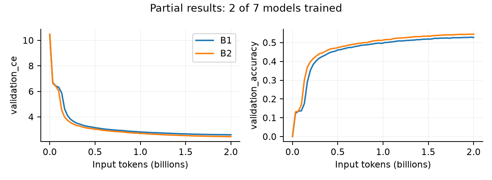

# BERT-Medium 阶段结果与中断修复

本报告仅覆盖已完成的 B1/B2 训练；七模型完整 Controlled Scaling 结论尚未产生。两模型均按冻结协议训练到精确 2,000,000,000 输入 token，动态 MLM 目标数均为 295,279,792，文档访问数均为 2,860,390。四个里程碑权重已保存。

## 2B 的 MLM 验证结果

在同一批 2,048 个固定验证文档上，2000 次按文档配对 bootstrap：

| 模型 | Validation CE（95% CI） | Masked-token accuracy（95% CI） | 实际训练 GPU-hours |
|---|---|---|---:|
| B1，W384/D8/H6 | 2.60297 [2.56395, 2.64490] | 52.756% [52.139%, 53.337%] | 0.6129 |
| B2，W512/D8/H8 | 2.45739 [2.41962, 2.49767] | 54.477% [53.853%, 55.050%] | 0.8034 |
| B2 − B1 | −0.14558 [−0.15457, −0.13626] | +1.721 百分点 [+1.436, +1.999] | — |

CI 条件于一个共同训练种子，不反映重复训练变异。这里的配对结果支持本次运行中 B2 的 MLM 表现优于 B1，不能推导 CFS 趋势或因果关系。

| 模型 | 0.5B CE | 1B CE | 1.5B CE | 2B CE |
|---|---:|---:|---:|---:|
| B1 | 3.15926 | 2.81942 | 2.66670 | 2.60297 |
| B2 | 3.03984 | 2.70842 | 2.53416 | 2.45739 |

两模型都正常学习，改善速度有所放缓；1B→2B 的 CE 仍分别下降约 7.7% 和 9.3%。这不能单独证明功能组织已稳定，也不是自动续训的理由。仍需完整的共同输入 CFS 稳定性检查，且不会自动启动 3B。

逐 checkpoint 数值见 [checkpoints.csv](partial_training/checkpoints.csv)，置信区间与配对差异见 [validation_paired.csv](partial_training/validation_paired.csv)，原始日志和逐文档验证记录位于 `runs/B1/`、`runs/B2/`。

复现本阶段统计：`python scripts/summarize_bert_medium_progress.py --root results/bert_medium_controlled_20261116`。

## 为什么后续实验暂停

B1/B2 完成训练后，1B CFS 的首输入检查失败，触发队列退出；当时另外五个模型尚未开始。错误发生在测量实现，训练权重没有损坏。B1 一个替代项相对差异约 2.11%，B2 最多约 3.02%，超出原定核验阈值。

原因是原缓存保留 batch=1 的最后层输入，然后扩展到干预 batch。FP16 前缀计算在不同 batch 大小下有舍入差异；训练后的模型对该误差更敏感，未训练 smoke test 没有暴露问题。

修复改为按每种实际干预 batch 大小分别缓存前缀，保持原完整前向的 FP16 数值路径。未放宽阈值，未修改 CFS/alpha 或统计定义。修复后，B1 四个核验输入、B2 原失败输入的删除及最佳替代 KL 与完整前向逐项相同，最大误差 0；alpha 一致率 100%。新增回归测试，六项 Medium 针对性测试通过。

原失败采集尚未写出正式矩阵 shard，不需要修改或混合旧矩阵。旧代码锁已归档，当前锁明确记录实现修复；训练协议 fingerprint 未变。

## 恢复后的状态

双卡队列已恢复，从 B1/B2 的 CFS 采集继续，然后按原顺序训练 B3–B7；B1/B2 不重复训练。恢复后两模型 1B/64 输入采集已完成，2B/256 输入采集进行中。尚不提供不完整七模型的 Scaling 结论。

最初 4–5 小时的墙钟估计已被中断打破。剩余纯训练按原短测约 4.3 GPU-hours，此外还需 CFS、验证和统计；具体完成时间以恢复后的实测进度更新。
