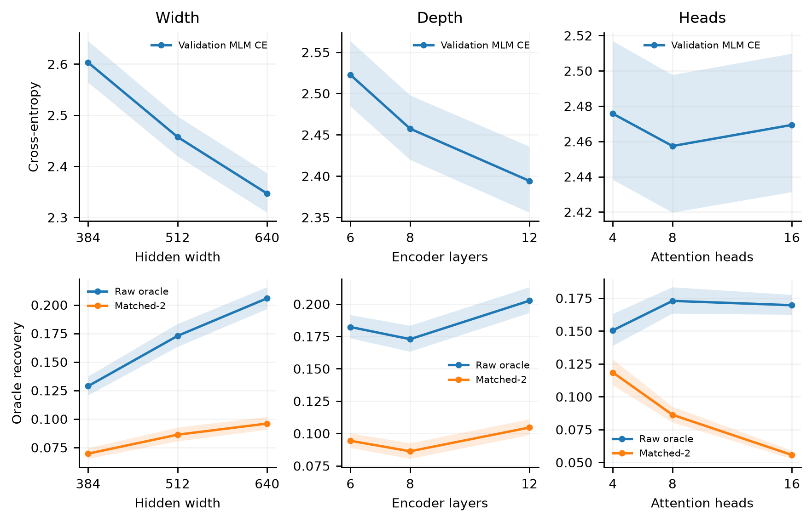
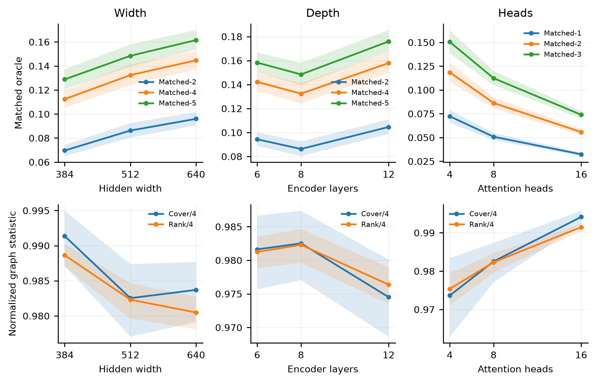

# BERT-Medium 七模型受控 Scaling：完整 2B 结果

七个模型均从随机初始化训练到精确 2,000,000,000 非 padding 输入位置；B2 是三轴共享的唯一基准。主结果固定为 2B，未按 CFS 选择 checkpoint，也未启动 3B。全部 28 个里程碑 checkpoint 保留远端，其路径与 SHA256 见 CHECKPOINT_MANIFEST.json。

## 主结果

| model   |     parameters |   validation_ce |   validation_accuracy |     raw |   matched_2 |   cover_full |   rank_full |
|:--------|---------------:|----------------:|----------------------:|--------:|------------:|-------------:|------------:|
| B1      | 26293434.00000 |         2.60297 |              52.75625 | 0.12881 |     0.06961 |      0.98568 |     0.98128 |
| B2      | 41404730.00000 |         2.45739 |              54.47713 | 0.17287 |     0.08624 |      0.96436 |     0.96147 |
| B3      | 59694522.00000 |         2.34675 |              56.11766 | 0.20582 |     0.09598 |      0.95937 |     0.94733 |
| B4      | 35099962.00000 |         2.52256 |              53.68407 | 0.18225 |     0.09431 |      0.96387 |     0.95928 |
| B5      | 54014266.00000 |         2.39415 |              55.61746 | 0.20258 |     0.10459 |      0.94775 |     0.94881 |
| B6      | 41404730.00000 |         2.47575 |              54.36310 | 0.15046 |     0.11845 |      0.97363 |     0.97537 |
| B7      | 41404730.00000 |         2.46935 |              54.43566 | 0.16960 |     0.05571 |      0.97534 |     0.96125 |

Accuracy 列为百分数；Mean deletion KL 单位为自然对数。256 个相同独立验证文档用于 CFS，2048 个用于 MLM 验证。全部均值、输入标准差、95% CI、配对差异和子图采样误差见 analysis/ 与 interpretation/；表中 Matched-4/5 对 H=4 不适用，保留缺失值。

## Q1：现有资源上的成本

实际训练进程累计占用 5.980 GPU-hours（含启动、验证和存盘）；成功 CFS 采集累计占用 1.653 GPU-hours。CFS 的占用时长包含 CPU 计算/传输等待，不等于 GPU 忙碌时间；准备、benchmark 和失败诊断未计入这两项。原 GPT-2 七模型训练记录约 38.00 GPU-hours，但架构、tokenizer、序列长度、目标和硬件型号均不同，不能当作受控加速倍数。

正式训练吞吐量以完整训练进程的墙钟时间计算，包含验证和存盘，详见 actual_costs.csv：

| model   |   training_tokens |   reserved_training_attempt_gpu_hours |   end_to_end_training_tokens_per_second |   mean_seconds_per_update_including_validation_io |   successful_cfs_allocation_gpu_hours |
|:--------|------------------:|--------------------------------------:|----------------------------------------:|--------------------------------------------------:|--------------------------------------:|
| B1      |   2000000000.0000 |                                0.6144 |                             904165.7395 |                                            0.0362 |                                0.0894 |
| B2      |   2000000000.0000 |                                0.8050 |                             690106.9216 |                                            0.0475 |                                0.1630 |
| B3      |   2000000000.0000 |                                1.1535 |                             481640.3028 |                                            0.0680 |                                0.2839 |
| B4      |   2000000000.0000 |                                0.6538 |                             849757.0607 |                                            0.0386 |                                0.1684 |
| B5      |   2000000000.0000 |                                1.1284 |                             492347.3441 |                                            0.0666 |                                0.1647 |
| B6      |   2000000000.0000 |                                0.8102 |                             685739.3713 |                                            0.0478 |                                0.0391 |
| B7      |   2000000000.0000 |                                0.8143 |                             682261.9228 |                                            0.0480 |                                0.7440 |

## Q2：训练充分性、非退化性与稳定性

2B 有效 source 比例范围为 100.0000%–100.0000%，mean deletion KL 为 0.004421–0.028744。这些结果支持删除干预在数值上非退化，不等于已实现推理压缩。

| model   | metric     |   mean_1B |   mean_2B |   change |   ci_low |   ci_high |   inputs |   finite_pairs |
|:--------|:-----------|----------:|----------:|---------:|---------:|----------:|---------:|---------------:|
| B1      | cover_full |   0.97656 |   0.98958 |  0.01302 |  0.00000 |   0.02865 |       64 |             64 |
| B1      | matched_2  |   0.08726 |   0.07017 | -0.01709 | -0.02854 |  -0.00695 |       64 |             64 |
| B1      | rank_full  |   0.97239 |   0.98130 |  0.00891 |  0.00318 |   0.01533 |       64 |             64 |
| B1      | raw        |   0.15852 |   0.12906 | -0.02946 | -0.04837 |  -0.01266 |       64 |             64 |
| B2      | cover_full |   0.96484 |   0.97461 |  0.00977 | -0.01562 |   0.03320 |       64 |             64 |
| B2      | matched_2  |   0.09416 |   0.08043 | -0.01373 | -0.02361 |  -0.00299 |       64 |             64 |
| B2      | rank_full  |   0.95966 |   0.96734 |  0.00768 | -0.00151 |   0.01599 |       64 |             64 |
| B2      | raw        |   0.18610 |   0.16033 | -0.02577 | -0.04245 |  -0.00821 |       64 |             64 |
| B3      | cover_full |   0.96406 |   0.97031 |  0.00625 | -0.01875 |   0.03437 |       64 |             64 |
| B3      | matched_2  |   0.10366 |   0.09211 | -0.01155 | -0.02297 |  -0.00065 |       64 |             64 |
| B3      | rank_full  |   0.94505 |   0.95205 |  0.00700 | -0.00514 |   0.01966 |       64 |             64 |
| B3      | raw        |   0.21163 |   0.19611 | -0.01551 | -0.03257 |   0.00162 |       64 |             64 |
| B4      | cover_full |   0.96289 |   0.96094 | -0.00195 | -0.02539 |   0.01953 |       64 |             64 |
| B4      | matched_2  |   0.09578 |   0.09457 | -0.00121 | -0.01034 |   0.00877 |       64 |             64 |
| B4      | rank_full  |   0.95595 |   0.95802 |  0.00208 | -0.00736 |   0.01186 |       64 |             64 |
| B4      | raw        |   0.18185 |   0.18066 | -0.00119 | -0.01423 |   0.01254 |       64 |             64 |
| B5      | cover_full |   0.95508 |   0.96094 |  0.00586 | -0.01758 |   0.02930 |       64 |             64 |
| B5      | matched_2  |   0.10499 |   0.10306 | -0.00192 | -0.01251 |   0.00891 |       64 |             64 |
| B5      | rank_full  |   0.94867 |   0.95380 |  0.00513 | -0.00494 |   0.01489 |       64 |             64 |
| B5      | raw        |   0.20243 |   0.19631 | -0.00612 | -0.02299 |   0.01071 |       64 |             64 |
| B6      | cover_full |   0.97656 |   0.96875 | -0.00781 | -0.03125 |   0.01172 |       64 |             64 |
| B6      | matched_2  |   0.13289 |   0.12154 | -0.01136 | -0.02763 |   0.00605 |       64 |             64 |
| B6      | rank_full  |   0.96897 |   0.97397 |  0.00500 | -0.00334 |   0.01338 |       64 |             64 |
| B6      | raw        |   0.17050 |   0.15577 | -0.01474 | -0.03557 |   0.00785 |       64 |             64 |
| B7      | cover_full |   0.97168 |   0.98145 |  0.00977 | -0.00002 |   0.02051 |       64 |             64 |
| B7      | matched_2  |   0.05670 |   0.05464 | -0.00206 | -0.00619 |   0.00221 |       64 |             64 |
| B7      | rank_full  |   0.95850 |   0.96334 |  0.00485 | -0.00033 |   0.01056 |       64 |             64 |
| B7      | raw        |   0.16901 |   0.16546 | -0.00355 | -0.01422 |   0.00698 |       64 |             64 |

上表只比较共同 64 输入，因此其 2B 均值不应与全 256 输入主表混用。1B→2B 部分 Oracle 变化区间不跨零；不能宣称所有模型的功能组织已完全稳定。CI 跨零也不是等价性证明。完整学习曲线及逐输入矩阵变化已保存。2B 仍是有效的预先指定等预算比较，但“充分稳定/收敛”的措辞应弱化；如需延长，须另行决定七模型共同 3B 协议，本次未启动。

逐输入矩阵稳定性的均值（共同有效源，仅描述性，不把 pair 当独立样本）：

| model   |   matrix_mae |   matrix_spearman |
|:--------|-------------:|------------------:|
| B1      |      0.03756 |           0.57238 |
| B2      |      0.04674 |           0.48188 |
| B3      |      0.05357 |           0.50269 |
| B4      |      0.04370 |           0.49927 |
| B5      |      0.05159 |           0.52449 |
| B6      |      0.05553 |           0.57123 |
| B7      |      0.03104 |           0.45101 |

## Q3：Width 与 Depth

Width B1→B2→B3：Raw 0.12881 → 0.17287 → 0.20582，Matched-2 0.06961 → 0.08624 → 0.09598。固定候选数后仍应依据配对区间判断，不以 Raw alone 代替候选控制。

本次 Width 的 Matched-2/4/5 均上升；Matched-2 两段配对区间均高于零。Fixed-K=4 的 Cover 不再单调，Rank/4 的 B2→B3 差异区间跨零，因此图指标的连续趋势证据比 Oracle 弱。

Depth B4→B2→B5：Raw 0.18225 → 0.17287 → 0.20258，Matched-2 0.09431 → 0.08624 → 0.10459。本次深度结果为非单调，不能给出简单的随深度增减规律。最终层的绝对深度随模型改变，这一限制保留。

## Q4：固定参数容量的 Head 分解

B6→B2→B7 均为 41,404,730 参数。Raw 0.15046 → 0.17287 → 0.16960；Matched-2 0.11845 → 0.08624 → 0.05571；MLM CE 2.47575 → 2.45739 → 2.46935。Raw 方向为 non-monotonic，Matched-2 为 decreasing。固定 K=4 的结果和配对区间同时展示；不能把 head 数带来的候选优势直接解释为同样强的固有替代性提升，也不能把关联解释成 CFS 对性能的因果收益。

本次 Matched-1/2/3 随 head 数增加而下降，Matched-2 两段差异的输入级区间均低于零。完整图 Rank/H 的下降在 Fixed-K=4 后变为 Rank/4 上升；这两个不同问题的统计量不能混为同一趋势。固定 K 的 Rank 两段配对区间均高于零，Cover 的第一段区间仍跨零。8-head 的 MLM CE 优于4/16-head，且对本次固定训练种子的两个配对 CE 区间均不跨零；没有独立训练种子重复，不能外推训练稳健性。

相邻模型的变化（right − left）及 95% 输入配对区间：

| axis   | left   | right   | metric        |   change |   ci_low |   ci_high |
|:-------|:-------|:--------|:--------------|---------:|---------:|----------:|
| width  | B1     | B2      | cover_4       | -0.00885 | -0.01446 |  -0.00353 |
| width  | B1     | B2      | rank_4        | -0.00633 | -0.00914 |  -0.00379 |
| width  | B1     | B2      | matched_2     |  0.01663 |  0.01029 |   0.02307 |
| width  | B1     | B2      | validation_ce | -0.14558 | -0.15457 |  -0.13626 |
| width  | B2     | B3      | cover_4       |  0.00118 | -0.00433 |   0.00717 |
| width  | B2     | B3      | rank_4        | -0.00182 | -0.00435 |   0.00092 |
| width  | B2     | B3      | matched_2     |  0.00974 |  0.00375 |   0.01543 |
| width  | B2     | B3      | validation_ce | -0.11063 | -0.11990 |  -0.10123 |
| depth  | B4     | B2      | cover_4       |  0.00090 | -0.00450 |   0.00648 |
| depth  | B4     | B2      | rank_4        |  0.00107 | -0.00119 |   0.00339 |
| depth  | B4     | B2      | matched_2     | -0.00807 | -0.01340 |  -0.00251 |
| depth  | B4     | B2      | validation_ce | -0.06517 | -0.07362 |  -0.05673 |
| depth  | B2     | B5      | cover_4       | -0.00801 | -0.01315 |  -0.00293 |
| depth  | B2     | B5      | rank_4        | -0.00593 | -0.00804 |  -0.00390 |
| depth  | B2     | B5      | matched_2     |  0.01836 |  0.01338 |   0.02329 |
| depth  | B2     | B5      | validation_ce | -0.06324 | -0.07273 |  -0.05359 |
| heads  | B6     | B2      | cover_4       |  0.00889 | -0.00040 |   0.01877 |
| heads  | B6     | B2      | rank_4        |  0.00693 |  0.00338 |   0.01046 |
| heads  | B6     | B2      | matched_2     | -0.03221 | -0.04033 |  -0.02370 |
| heads  | B6     | B2      | validation_ce | -0.01836 | -0.02623 |  -0.01021 |
| heads  | B2     | B7      | cover_4       |  0.01161 |  0.00709 |   0.01677 |
| heads  | B2     | B7      | rank_4        |  0.00918 |  0.00701 |   0.01168 |
| heads  | B2     | B7      | matched_2     | -0.03053 | -0.03559 |  -0.02542 |
| heads  | B2     | B7      | validation_ce |  0.01196 |  0.00364 |   0.02035 |

## Q5：跨架构结论与限制

原 CFS 干预、输出 KL、alpha grid 和最终论文 Cover/Rank 实现能在这套从头训练的双向 MLM 家族上产生可比较的非退化矩阵。这支持受控分析从原 decoder 家族拓展到 bidirectional encoder；它不保证跨架构方向一致或普适单调规律。本报告不将仓库旧 section5 中的受控 ViT 表误作 GPT-2 对照，也不跨不同输出协议直接比较绝对 CFS。

区间均为 2000 次文档级 bootstrap，只覆盖输入不确定性，不包含独立训练种子变异；多指标区间未做多重比较校正。Fixed-K 的500次子图抽样在每个输入内进行，未作为独立样本；H=K 时只计算一次。sampling_precision.csv 单独给出 Monte Carlo SE 与100/250/500次的敏感性。

clarified_trends.csv 将全相等的指标标为 constant；原自动分析的非严格单调标签不能把恒为100%的有效源比例解读成增长。

## 数值修复与可复现性

首次训练完成后 CFS 曾因 FP16 batch 形状的前缀缓存舍入差异暂停。修复为按实际干预 batch 形状缓存，保留原误差阈值与数学协议。训练权重未重训，失败阶段无正式矩阵 shard；实现修订与旧代码锁均归档。每个 checkpoint 的首输入仍核验缓存/完整前向的一致性。

复现命令与文件用途见 docs/BERT_MEDIUM_CONTROLLED_PROTOCOL.md；分析命令为 `python scripts/analyze_bert_medium.py --root RUN_ROOT`，本报告命令为 `python scripts/report_bert_medium_results.py --root RUN_ROOT`。原始矩阵、逐输入统计、bootstrap、CSV/JSON/LaTeX 与 PDF/PNG 均已保留。

