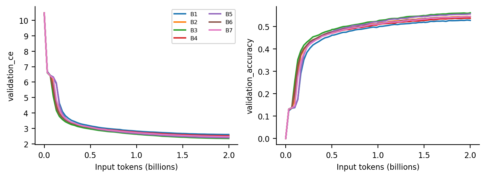
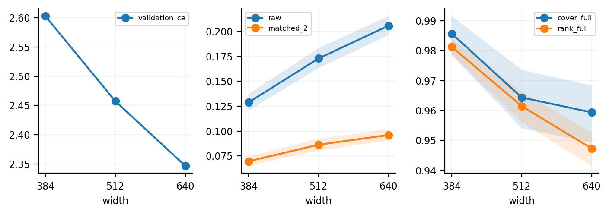
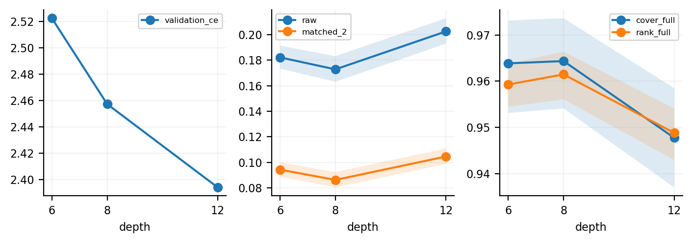
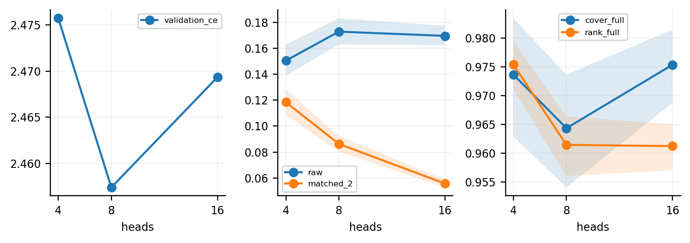
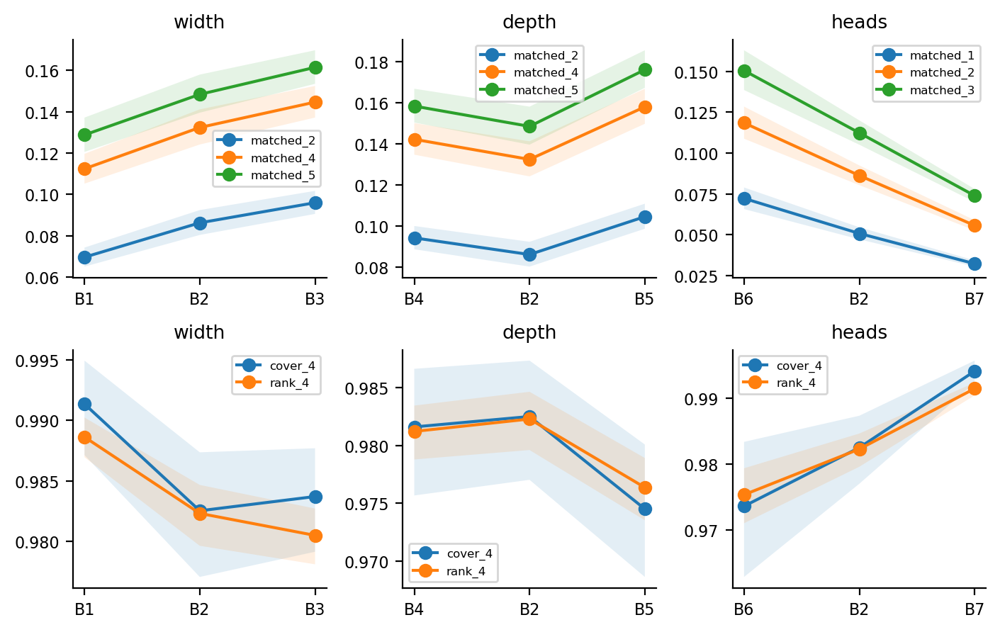

# BERT-Medium controlled scaling at the prespecified2B checkpoint

All seven models trained from scratch with one common seed and exactly2,000,000,000 nonpadding input positions; B2 is reused across axes. No individual early stopping, favorable-CFS checkpoint selection or3B continuation was performed.

| model   |      parameters |   validation_ce |   validation_accuracy |   train_ce |   training_tokens |   masked_positions |   document_visits |   training_gpu_hours |   reserved_training_attempt_gpu_hours |   validation_ce_ci_low |   validation_ce_ci_high |   validation_accuracy_ci_low |   validation_accuracy_ci_high |   cover_4 |   cover_full |   matched_1 |   matched_2 |   matched_3 |   matched_4 |   matched_5 |   mean_deletion_kl |   mean_deletion_kl_all |   rank_4 |   rank_full |      raw |   valid_source_ratio |
|:--------|----------------:|----------------:|----------------------:|-----------:|------------------:|-------------------:|------------------:|---------------------:|--------------------------------------:|-----------------------:|------------------------:|-----------------------------:|------------------------------:|----------:|-------------:|------------:|------------:|------------:|------------:|------------:|-------------------:|-----------------------:|---------:|------------:|---------:|---------------------:|
| B1      | 26293434.000000 |        2.602965 |              0.527562 |   2.768080 | 2000000000.000000 |   295279792.000000 |    2860390.000000 |             0.612992 |                              0.614440 |               2.563951 |                2.644901 |                     0.521387 |                      0.533372 |  0.991367 |     0.985677 |    0.039930 |    0.069609 |    0.093066 |    0.112401 |    0.128808 |           0.014106 |               0.014106 | 0.988633 |    0.981276 | 0.128808 |             1.000000 |
| B2      | 41404730.000000 |        2.457388 |              0.544771 |   2.622295 | 2000000000.000000 |   295279792.000000 |    2860390.000000 |             0.803522 |                              0.805028 |               2.419618 |                2.497669 |                     0.538533 |                      0.550498 |  0.982521 |     0.964355 |    0.050806 |    0.086239 |    0.112323 |    0.132400 |    0.148434 |           0.010109 |               0.010109 | 0.982304 |    0.961472 | 0.172868 |             1.000000 |
| B3      | 59694522.000000 |        2.346753 |              0.561177 |   2.516917 | 2000000000.000000 |   295279792.000000 |    2860390.000000 |             1.151812 |                              1.153466 |               2.309489 |                2.386463 |                     0.554991 |                      0.566899 |  0.983701 |     0.959375 |    0.057830 |    0.095976 |    0.123561 |    0.144683 |    0.161514 |           0.004439 |               0.004439 | 0.980481 |    0.947326 | 0.205819 |             1.000000 |
| B4      | 35099962.000000 |        2.522562 |              0.536841 |   2.690165 | 2000000000.000000 |   295279792.000000 |    2860390.000000 |             0.652240 |                              0.653782 |               2.484395 |                2.563486 |                     0.530609 |                      0.542617 |  0.981621 |     0.963867 |    0.056479 |    0.094311 |    0.121574 |    0.142160 |    0.158282 |           0.014789 |               0.014789 | 0.981232 |    0.959283 | 0.182246 |             1.000000 |
| B5      | 54014266.000000 |        2.394147 |              0.556175 |   2.554731 | 2000000000.000000 |   295279792.000000 |    2860390.000000 |             1.126757 |                              1.128381 |               2.355745 |                2.435612 |                     0.549929 |                      0.562098 |  0.974516 |     0.947754 |    0.062713 |    0.104594 |    0.134911 |    0.157898 |    0.175921 |           0.008286 |               0.008286 | 0.976374 |    0.948815 | 0.202582 |             1.000000 |
| B6      | 41404730.000000 |        2.475746 |              0.543631 |   2.640936 | 2000000000.000000 |   295279792.000000 |    2860390.000000 |             0.807657 |                              0.810156 |               2.438242 |                2.516890 |                     0.537348 |                      0.549597 |  0.973633 |     0.973633 |    0.072248 |    0.118452 |    0.150461 |  nan        |  nan        |           0.028744 |               0.028744 | 0.975370 |    0.975370 | 0.150461 |             1.000000 |
| B7      | 41404730.000000 |        2.469347 |              0.544357 |   2.632643 | 2000000000.000000 |   295279792.000000 |    2860390.000000 |             0.812778 |                              0.814285 |               2.431215 |                2.509708 |                     0.538141 |                      0.550063 |  0.994133 |     0.975342 |    0.032327 |    0.055707 |    0.073927 |    0.088782 |    0.101264 |           0.004421 |               0.004421 | 0.991483 |    0.961253 | 0.169596 |             1.000000 |

## Q1: cost and learning

Actual training hours and validation curves are above; benchmark estimates are in ../benchmark/. GPU-hours in the completion state exclude replayed attempts; reserved_training_attempt_gpu_hours includes them.

## Q2: functional stability and degeneracy

| model   | metric               |   mean_1B |   mean_2B |    change |    ci_low |   ci_high |   inputs |   finite_pairs |
|:--------|:---------------------|----------:|----------:|----------:|----------:|----------:|---------:|---------------:|
| B1      | cover_full           |  0.976562 |  0.989583 |  0.013021 |  0.000000 |  0.028646 |       64 |             64 |
| B1      | matched_1            |  0.050809 |  0.040357 | -0.010452 | -0.017929 | -0.003596 |       64 |             64 |
| B1      | matched_2            |  0.087259 |  0.070169 | -0.017090 | -0.028537 | -0.006955 |       64 |             64 |
| B1      | matched_3            |  0.115563 |  0.093583 | -0.021980 | -0.036171 | -0.009342 |       64 |             64 |
| B1      | matched_4            |  0.138775 |  0.112810 | -0.025965 | -0.042370 | -0.011326 |       64 |             64 |
| B1      | matched_5            |  0.158520 |  0.129060 | -0.029460 | -0.048368 | -0.012664 |       64 |             64 |
| B1      | mean_deletion_kl     |  0.013835 |  0.013534 | -0.000300 | -0.001398 |  0.000721 |       64 |             64 |
| B1      | mean_deletion_kl_all |  0.013835 |  0.013534 | -0.000300 | -0.001398 |  0.000721 |       64 |             64 |
| B1      | rank_full            |  0.972390 |  0.981304 |  0.008914 |  0.003184 |  0.015331 |       64 |             64 |
| B1      | raw                  |  0.158520 |  0.129060 | -0.029460 | -0.048368 | -0.012664 |       64 |             64 |
| B1      | valid_source_ratio   |  1.000000 |  1.000000 |  0.000000 |  0.000000 |  0.000000 |       64 |             64 |
| B2      | cover_full           |  0.964844 |  0.974609 |  0.009766 | -0.015625 |  0.033203 |       64 |             64 |
| B2      | matched_1            |  0.056373 |  0.047749 | -0.008624 | -0.014953 | -0.001854 |       64 |             64 |
| B2      | matched_2            |  0.094155 |  0.080430 | -0.013725 | -0.023609 | -0.002989 |       64 |             64 |
| B2      | matched_3            |  0.121867 |  0.104362 | -0.017505 | -0.029491 | -0.004291 |       64 |             64 |
| B2      | matched_4            |  0.143255 |  0.122793 | -0.020463 | -0.034049 | -0.005467 |       64 |             64 |
| B2      | matched_5            |  0.160346 |  0.137585 | -0.022761 | -0.037499 | -0.006719 |       64 |             64 |
| B2      | mean_deletion_kl     |  0.009574 |  0.010074 |  0.000501 | -0.000194 |  0.001242 |       64 |             64 |
| B2      | mean_deletion_kl_all |  0.009574 |  0.010074 |  0.000501 | -0.000194 |  0.001242 |       64 |             64 |
| B2      | rank_full            |  0.959662 |  0.967341 |  0.007679 | -0.001513 |  0.015993 |       64 |             64 |
| B2      | raw                  |  0.186097 |  0.160326 | -0.025771 | -0.042454 | -0.008207 |       64 |             64 |
| B2      | valid_source_ratio   |  1.000000 |  1.000000 |  0.000000 |  0.000000 |  0.000000 |       64 |             64 |
| B3      | cover_full           |  0.964063 |  0.970313 |  0.006250 | -0.018750 |  0.034375 |       64 |             64 |
| B3      | matched_1            |  0.064290 |  0.055819 | -0.008471 | -0.016496 | -0.000777 |       64 |             64 |
| B3      | matched_2            |  0.103662 |  0.092107 | -0.011555 | -0.022970 | -0.000647 |       64 |             64 |
| B3      | matched_3            |  0.131321 |  0.118207 | -0.013114 | -0.026363 | -0.000279 |       64 |             64 |
| B3      | matched_4            |  0.152174 |  0.138151 | -0.014023 | -0.028572 |  0.000015 |       64 |             64 |
| B3      | matched_5            |  0.168627 |  0.154050 | -0.014578 | -0.029903 |  0.000325 |       64 |             64 |
| B3      | mean_deletion_kl     |  0.003655 |  0.004434 |  0.000779 |  0.000351 |  0.001205 |       64 |             64 |
| B3      | mean_deletion_kl_all |  0.003655 |  0.004434 |  0.000779 |  0.000351 |  0.001205 |       64 |             64 |
| B3      | rank_full            |  0.945048 |  0.952051 |  0.007003 | -0.005142 |  0.019665 |       64 |             64 |
| B3      | raw                  |  0.211626 |  0.196113 | -0.015513 | -0.032574 |  0.001618 |       64 |             64 |
| B3      | valid_source_ratio   |  1.000000 |  1.000000 |  0.000000 |  0.000000 |  0.000000 |       64 |             64 |
| B4      | cover_full           |  0.962891 |  0.960938 | -0.001953 | -0.025391 |  0.019531 |       64 |             64 |
| B4      | matched_1            |  0.057340 |  0.057144 | -0.000196 | -0.006345 |  0.006942 |       64 |             64 |
| B4      | matched_2            |  0.095780 |  0.094570 | -0.001211 | -0.010335 |  0.008768 |       64 |             64 |
| B4      | matched_3            |  0.123107 |  0.121286 | -0.001821 | -0.012672 |  0.009685 |       64 |             64 |
| B4      | matched_4            |  0.143341 |  0.141417 | -0.001924 | -0.013941 |  0.010648 |       64 |             64 |
| B4      | matched_5            |  0.158883 |  0.157186 | -0.001697 | -0.014422 |  0.011410 |       64 |             64 |
| B4      | mean_deletion_kl     |  0.015001 |  0.015417 |  0.000417 | -0.000712 |  0.001533 |       64 |             64 |
| B4      | mean_deletion_kl_all |  0.015001 |  0.015417 |  0.000417 | -0.000712 |  0.001533 |       64 |             64 |
| B4      | rank_full            |  0.955947 |  0.958023 |  0.002076 | -0.007359 |  0.011863 |       64 |             64 |
| B4      | raw                  |  0.181853 |  0.180659 | -0.001194 | -0.014234 |  0.012539 |       64 |             64 |
| B4      | valid_source_ratio   |  1.000000 |  1.000000 |  0.000000 |  0.000000 |  0.000000 |       64 |             64 |
| B5      | cover_full           |  0.955078 |  0.960938 |  0.005859 | -0.017578 |  0.029297 |       64 |             64 |
| B5      | matched_1            |  0.063112 |  0.062873 | -0.000239 | -0.007089 |  0.006658 |       64 |             64 |
| B5      | matched_2            |  0.104987 |  0.103064 | -0.001923 | -0.012514 |  0.008914 |       64 |             64 |
| B5      | matched_3            |  0.135141 |  0.131824 | -0.003317 | -0.016229 |  0.009819 |       64 |             64 |
| B5      | matched_4            |  0.157965 |  0.153574 | -0.004391 | -0.018690 |  0.010124 |       64 |             64 |
| B5      | matched_5            |  0.175850 |  0.170676 | -0.005174 | -0.020536 |  0.010518 |       64 |             64 |
| B5      | mean_deletion_kl     |  0.007876 |  0.007848 | -0.000028 | -0.000781 |  0.000914 |       64 |             64 |
| B5      | mean_deletion_kl_all |  0.007876 |  0.007848 | -0.000028 | -0.000781 |  0.000914 |       64 |             64 |
| B5      | rank_full            |  0.948672 |  0.953801 |  0.005128 | -0.004938 |  0.014885 |       64 |             64 |
| B5      | raw                  |  0.202434 |  0.196311 | -0.006122 | -0.022988 |  0.010712 |       64 |             64 |
| B5      | valid_source_ratio   |  1.000000 |  1.000000 |  0.000000 |  0.000000 |  0.000000 |       64 |             64 |
| B6      | cover_full           |  0.976562 |  0.968750 | -0.007812 | -0.031250 |  0.011719 |       64 |             64 |
| B6      | matched_1            |  0.080696 |  0.072954 | -0.007742 | -0.018077 |  0.002548 |       64 |             64 |
| B6      | matched_2            |  0.132894 |  0.121535 | -0.011359 | -0.027632 |  0.006049 |       64 |             64 |
| B6      | matched_3            |  0.170502 |  0.155765 | -0.014737 | -0.035570 |  0.007846 |       64 |             64 |
| B6      | mean_deletion_kl     |  0.027952 |  0.026053 | -0.001899 | -0.004874 |  0.000602 |       64 |             64 |
| B6      | mean_deletion_kl_all |  0.027952 |  0.026053 | -0.001899 | -0.004874 |  0.000602 |       64 |             64 |
| B6      | rank_full            |  0.968972 |  0.973972 |  0.005001 | -0.003339 |  0.013375 |       64 |             64 |
| B6      | raw                  |  0.170502 |  0.155765 | -0.014737 | -0.035570 |  0.007846 |       64 |             64 |
| B6      | valid_source_ratio   |  1.000000 |  1.000000 |  0.000000 |  0.000000 |  0.000000 |       64 |             64 |
| B7      | cover_full           |  0.971680 |  0.981445 |  0.009766 | -0.000024 |  0.020508 |       64 |             64 |
| B7      | matched_1            |  0.032897 |  0.031815 | -0.001082 | -0.003617 |  0.001534 |       64 |             64 |
| B7      | matched_2            |  0.056700 |  0.054642 | -0.002058 | -0.006191 |  0.002212 |       64 |             64 |
| B7      | matched_3            |  0.075166 |  0.072378 | -0.002788 | -0.008104 |  0.002659 |       64 |             64 |
| B7      | matched_4            |  0.090116 |  0.086820 | -0.003297 | -0.009490 |  0.003069 |       64 |             64 |
| B7      | matched_5            |  0.102587 |  0.098949 | -0.003638 | -0.010584 |  0.003399 |       64 |             64 |
| B7      | mean_deletion_kl     |  0.004292 |  0.004375 |  0.000082 | -0.000222 |  0.000373 |       64 |             64 |
| B7      | mean_deletion_kl_all |  0.004292 |  0.004375 |  0.000082 | -0.000222 |  0.000373 |       64 |             64 |
| B7      | rank_full            |  0.958495 |  0.963345 |  0.004849 | -0.000333 |  0.010559 |       64 |             64 |
| B7      | raw                  |  0.169009 |  0.165457 | -0.003552 | -0.014224 |  0.006975 |       64 |             64 |
| B7      | valid_source_ratio   |  1.000000 |  1.000000 |  0.000000 |  0.000000 |  0.000000 |       64 |             64 |

Valid-source fractions and deletion KL quantify intervention degeneracy. The64-input paired changes assess1B to2B, not an equivalence guarantee. Inspect matrix_stability_per_input.csv as aggregate stability can hide changing pairwise relationships. Low MLM accuracy alone does not prove sufficient task difficulty; slowly improving CE alone does not require unlimited training. Any proposed3B extension must be decided jointly for all seven after these results; it is not started automatically.

## Q3/Q4: observed width, depth and fixed-capacity trends

| axis   | metric             | direction     |
|:-------|:-------------------|:--------------|
| width  | raw                | increasing    |
| width  | cover_full         | decreasing    |
| width  | rank_full          | decreasing    |
| width  | valid_source_ratio | increasing    |
| width  | mean_deletion_kl   | decreasing    |
| width  | cover_4            | non-monotonic |
| width  | rank_4             | decreasing    |
| width  | matched_2          | increasing    |
| width  | matched_4          | increasing    |
| width  | matched_5          | increasing    |
| width  | validation_ce      | decreasing    |
| depth  | raw                | non-monotonic |
| depth  | cover_full         | non-monotonic |
| depth  | rank_full          | non-monotonic |
| depth  | valid_source_ratio | increasing    |
| depth  | mean_deletion_kl   | decreasing    |
| depth  | cover_4            | non-monotonic |
| depth  | rank_4             | non-monotonic |
| depth  | matched_2          | non-monotonic |
| depth  | matched_4          | non-monotonic |
| depth  | matched_5          | non-monotonic |
| depth  | validation_ce      | decreasing    |
| heads  | raw                | non-monotonic |
| heads  | cover_full         | non-monotonic |
| heads  | rank_full          | decreasing    |
| heads  | valid_source_ratio | increasing    |
| heads  | mean_deletion_kl   | decreasing    |
| heads  | cover_4            | increasing    |
| heads  | rank_4             | increasing    |
| heads  | matched_1          | decreasing    |
| heads  | matched_2          | decreasing    |
| heads  | matched_3          | decreasing    |
| heads  | validation_ce      | non-monotonic |

Paired differences and intervals are in paired.csv. Head decomposition holds parameter tensors/count fixed at initialization, but performance associations do not prove that changing CFS causes improvement.

## Q5 and statistical limits

The original intervention and MLM output-KL protocol is evaluated in a second bidirectional controlled family. Whether trends agree with GPT-2 is an empirical comparison, not an assumed result; three-point trends cannot establish universal laws. Bootstrap resamples whole independent validation documents2000 times. The original BERT mean-over-input Oracle aggregation is retained, rather than substituting valid-source-weighted global ratios. Rank uses the final-paper clipped affinity and unit self-connections from build_section5_delivery.py; the older BERT-only no-self rank is obsolete. FixedK4 has500 independent subsets per input (H=4 once), with Monte Carlo SE and100/250/500-draw checks saved separately. Input CIs do not capture independent training-seed variation.

