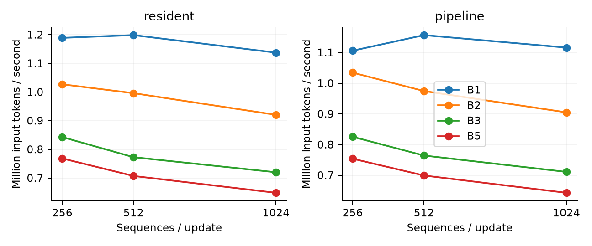

# BERT controlled-family throughput benchmark

ViT training was stopped at the user's request. This experiment contains finite throughput measurements only: no BERT checkpoints, formal training, CFS or bootstrap.

## Measured protocol

Hardware: two NVIDIA RTX PRO 6000 Blackwell Workstation Edition GPUs, 95.0 GiB each; PyTorch 2.7.1+cu128, Transformers 4.51.3. Two independent GPU jobs, no distributed training. B1=192/12/3, B2=256/12/4, B3=320/12/5, B5=256/18/4 (width/depth/heads). Randomly initialized HF BertForMaskedLM, FFN4x, post-LayerNorm, GELU, learned positions, tied vocabulary weights, dropout0.1, no NSP. BF16 autocast with FP32 weights/AdamW, fused AdamW, no torch.compile. Actual profiler operators confirm Flash Attention forward and backward. Only selected MLM hidden states enter the pointwise prediction transform, vocabulary projection and cross-entropy; the full encoder still processes every token. Dynamic Bernoulli15% masking over eligible tokens,80%MASK/10%random/10%unchanged, excluded special tokens.

Each of24 cases used50 warmup +100 timed updates, including masking, zero-grad, forward, loss, backward and optimizer step. A further four end-to-end cases at common batch256 used50 warmup +200 timed updates because the initial windows were short. GPU-resident synthetic tokens omit host supply; pipeline tests include shuffled memory-mapped real WordPiece cache,2 persistent loading workers, pinned memory and host-to-device copy. Tokenization/preparation is offline and excluded from training throughput. nvidia-smi samples utilization every0.5seconds; short windows limit precision.

FP32 dense-versus-selected loss/gradient checks passed on both GPUs; maximum gradient absolute difference 2.83e-07. TF32 and dropout were disabled only for equivalence checks; benchmark dropout remains0.1. CPU unit tests also passed.

## Throughput and batch choice

Common batch256 minimizes summed time for the four measured models. This is a throughput choice, not a validated convergence recipe. The table pairs original resident measurements with200-update real-data confirmation; repeat_change compares the latter to the original100-update pipeline run.

| model   |   resident_tokens_per_second |   input_tokens_per_second |   seconds_per_update |   gpu_utilization_mean |   peak_allocated_gib |   peak_reserved_gib |   repeat_change_percent |   pipeline_vs_resident_percent |
|:--------|-----------------------------:|--------------------------:|---------------------:|-----------------------:|---------------------:|--------------------:|------------------------:|-------------------------------:|
| B1      |                 1188764.4953 |              1157216.8166 |               0.0283 |                87.1818 |               4.8782 |             10.3340 |                  4.6504 |                        -2.6538 |
| B2      |                 1026694.8012 |              1048610.0177 |               0.0312 |                93.7500 |               5.9495 |             14.7441 |                  1.3935 |                         2.1345 |
| B3      |                  842540.4251 |               816642.3184 |               0.0401 |                92.6000 |               7.0692 |             12.3262 |                 -1.0219 |                        -3.0738 |
| B5      |                  768035.9715 |               750264.6596 |               0.0437 |                93.2500 |               7.9800 |             13.4707 |                 -0.4442 |                        -2.3139 |



Larger batches did not uniformly improve throughput. Allocated tensor memory and allocator-reserved memory are different; both are reported. The24-case raw table includes every tested batch, timing distribution and telemetry; no slow result was filtered.

## Original corpus and small real-data cache

Original GPT-2 corpus: HuggingFaceFW/fineweb / sample-10BT, revision `9bb295ddab0e05d785b879661af7260fed5140fc` (not FineWeb-Edu). Its source manifest lists 15 Parquet shards totaling 30,639,384,917 bytes; the name10BT denotes the source subset, not the per-model budget. The frozen train stream has 3,000,500,225 GPT-2 BPE tokens including one lookahead token; validation has 1,048,577. Preparation recorded 4,309,597 train and 4,370 validation documents including the last tokenization batch; those counts are not exact distinct documents wholly consumed by training. Train/validation assignment hashes original UTF-8 text with BLAKE2b(seed42 + NUL + text), modulo1000, bucket0 for validation. There was no original test split.

For this benchmark, read only 9,605,775 source bytes by bounded HTTP ranges from `sample/10BT/008_00000.parquet`, the original seeded order's first shard. Use 2,048 documents, exclude 1 validation document, produce 9,799 blocks / 1,254,272 input tokens. No full dataset download or processing. Pinned revision and per-range hashes are retained; the complete2GB shard hash was not reverified because it was not downloaded. Tokenizer-only `google-bert/bert-base-uncased` revision `86b5e0934494bd15c9632b12f734a8a67f723594`, vocabulary30,522; no pretrained weights loaded. Each block contains126 WordPiece text tokens within one document plus CLS/SEP. Short tails are dropped for this speed test. The small cache repeats and is not a final training corpus.

## Seven-model cost projections

Only B1/B2/B3/B5 were benchmarked. For planning the seven-model family, assume B4=W256/D9/H4, B6=W256/D12/H2, B7=W256/D12/H8. B4 uses linear depth-time extrapolation from measured D12/D18; B6/B7 use B2 as a proxy. Their head dimensions and kernels can change throughput, so these are not measurements. Input-token budgets count128 positions per sequence (including CLS/SEP), not masked prediction targets; content-only counts are126/128 as large. At15% eligible masking, supervised targets are approximately14.8% of input positions.

| model   |   input_tokens_per_second | basis                                               |   gpu_hours_100M |   gpu_hours_300M |   gpu_hours_1B |
|:--------|--------------------------:|:----------------------------------------------------|-----------------:|-----------------:|---------------:|
| B1      |             1157216.81662 | measured200-update pipeline confirmation            |          0.02400 |          0.07201 |        0.24004 |
| B2      |             1048610.01774 | measured200-update pipeline confirmation            |          0.02649 |          0.07947 |        0.26490 |
| B3      |              816642.31844 | measured200-update pipeline confirmation            |          0.03401 |          0.10204 |        0.34015 |
| B4      |             1308843.01158 | linear-depth extrapolation from B2/B5               |          0.02122 |          0.06367 |        0.21223 |
| B5      |              750264.65958 | measured200-update pipeline confirmation            |          0.03702 |          0.11107 |        0.37024 |
| B6      |             1048610.01774 | B2 throughput proxy; head dimension not benchmarked |          0.02649 |          0.07947 |        0.26490 |
| B7      |             1048610.01774 | B2 throughput proxy; head dimension not benchmarked |          0.02649 |          0.07947 |        0.26490 |

| input_tokens_per_model   |   total_gpu_hours |   two_gpu_hours |   three_gpu_hours |   ideal_total_divided_by2 |   ideal_total_divided_by3 |   two_gpu_with30percent_allowance |   three_gpu_with30percent_allowance |
|:-------------------------|------------------:|----------------:|------------------:|--------------------------:|--------------------------:|----------------------------------:|------------------------------------:|
| 100M                     |            0.1957 |          0.0982 |            0.0717 |                    0.0979 |                    0.0652 |                            0.1277 |                              0.0932 |
| 300M                     |            0.5872 |          0.2946 |            0.2152 |                    0.2936 |                    0.1957 |                            0.3830 |                              0.2797 |
| 1B                       |            1.9574 |          0.9821 |            0.7172 |                    0.9787 |                    0.6525 |                            1.2767 |                              0.9323 |

GPU-hours are steady-state training-only extrapolations. Wall times use optimal assignment of seven independent whole-model jobs; the ideal total/cards lower bound is also supplied. The third GPU is hypothetical: only two exist here and three-way CPU/memory contention was not tested. A30% allowance is an illustrative planning scenario, not a measured confidence interval. Preparation, validation, checkpointing, failures, CFS and final analysis are excluded; short-window speeds do not establish multi-hour thermal or IO stability.

## Historical GPT-2 measured costs

| model   |   width |   depth |   heads |   sequence_length |   input_tokens |   gpu_hours |   wall_input_tokens_per_second |
|:--------|--------:|--------:|--------:|------------------:|---------------:|------------:|-------------------------------:|
| W576    |     576 |      12 |       9 |              1024 |     3000500224 |       3.747 |                     222423.132 |
| W768    |     768 |      12 |      12 |              1024 |     3000500224 |       4.947 |                     168496.535 |
| W1152   |    1152 |      12 |      18 |              1024 |     3000500224 |       8.113 |                     102738.694 |
| D9      |     768 |       9 |      12 |              1024 |     3000500224 |       3.937 |                     211704.235 |
| D18     |     768 |      18 |      12 |              1024 |     3000500224 |       6.961 |                     119741.658 |
| H6      |     768 |      12 |       6 |              1024 |     3000500224 |       4.984 |                     167230.038 |
| H24     |     768 |      12 |      24 |              1024 |     3000500224 |       5.314 |                     156835.669 |

Seven successful runs total 38.002 GPU-hours for 21,003,501,568 tokens (3,000,500,224 per model). Each log contains one starting event and5723 updates; global batch524288 tokens, sequence1024, gradient accumulation16 with microbatch32, BF16 and torch.compile. Completion wall time includes that run's validation/checkpoint overhead, but not all historical pilots/billing or CFS. BERT has much smaller widths, sequence128, different tokenizer/objective and sparse supervised vocabulary projection; the comparison is a practical job-cost comparison, not an architecture-controlled speedup claim.

The historical GPU is recorded as PRO6000 Blackwell Server Edition; current GPUs are Workstation Edition. Historical Torch2.8.0/Transformers4.57.6 also differ from this run.

| input_tokens_per_model   |   historical_gpt2_observed_gpu_hours |   small_bert_projected_gpu_hours |
|:-------------------------|-------------------------------------:|---------------------------------:|
| 100M                     |                               1.2703 |                           0.1957 |
| 300M                     |                               3.8053 |                           0.5872 |
| 1B                       |                              12.6586 |                           1.9574 |

Historical budget costs above come from first logged updates crossing each token threshold, not scaling the3B completion time. They use integer-second log timestamps and exclude validation/saving immediately after that update; exact reached token counts are in gpt2_audit/observed_budget_costs.csv. The same caveats about architecture, sequence length, tokenization, hardware and target density apply.

Successful BERT timed+warmup windows consumed 0.1010 GPU-hours in total; correctness/profiling/import/IO setup and the initial failed numerical check are outside that sum. These measurements indicate the small seven-model BERT family is computationally feasible on the two current PRO6000 GPUs at the requested budgets. They do not establish convergence, functional stability, scientific comparability to GPT-2, or adequacy of100M/300M/1B tokens. No formal training is started.

## Reproduction

```bash
# In /data/cfs_bert_benchmark_20261116, use the existing task Python.
PY=/data/cfs_rebuttal_20261114/venv/bin/python
export OPENBLAS_NUM_THREADS=1 OMP_NUM_THREADS=2 TOKENIZERS_PARALLELISM=false
$PY scripts/prepare_bert_benchmark.py --root "$PWD" --gpt2-metadata gpt2_data_metadata.json --endpoint https://hf-mirror.com
CUDA_VISIBLE_DEVICES=0 $PY scripts/benchmark_bert_controlled.py --root "$PWD" --gpu 0 --models B1 B3 &
CUDA_VISIBLE_DEVICES=1 $PY scripts/benchmark_bert_controlled.py --root "$PWD" --gpu 1 --models B2 B5 &
wait
# Repeat with --updates 200 --batches 256 --modes pipeline --output-name confirmation
```

Use a new output directory to rerun; existing completed measurements are preserved. Analysis: `python scripts/analyze_bert_benchmark.py --root results/bert_throughput_20261116`. Implementation references: [HF BERT](https://huggingface.co/docs/transformers/v4.50.0/en/model_doc/bert), [PyTorch SDPA](https://docs.pytorch.org/docs/main/generated/torch.nn.functional.scaled_dot_product_attention.html).
