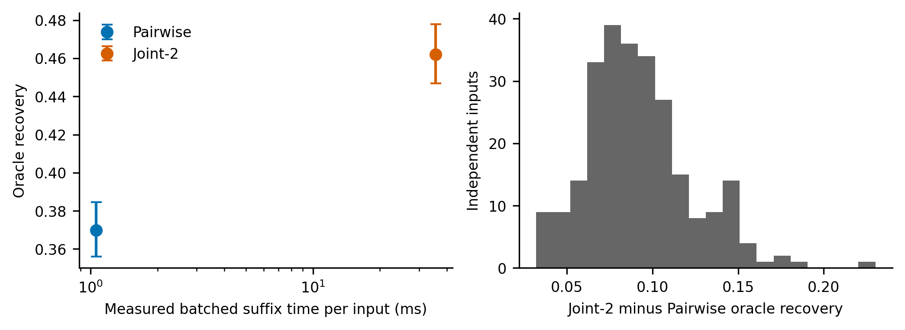
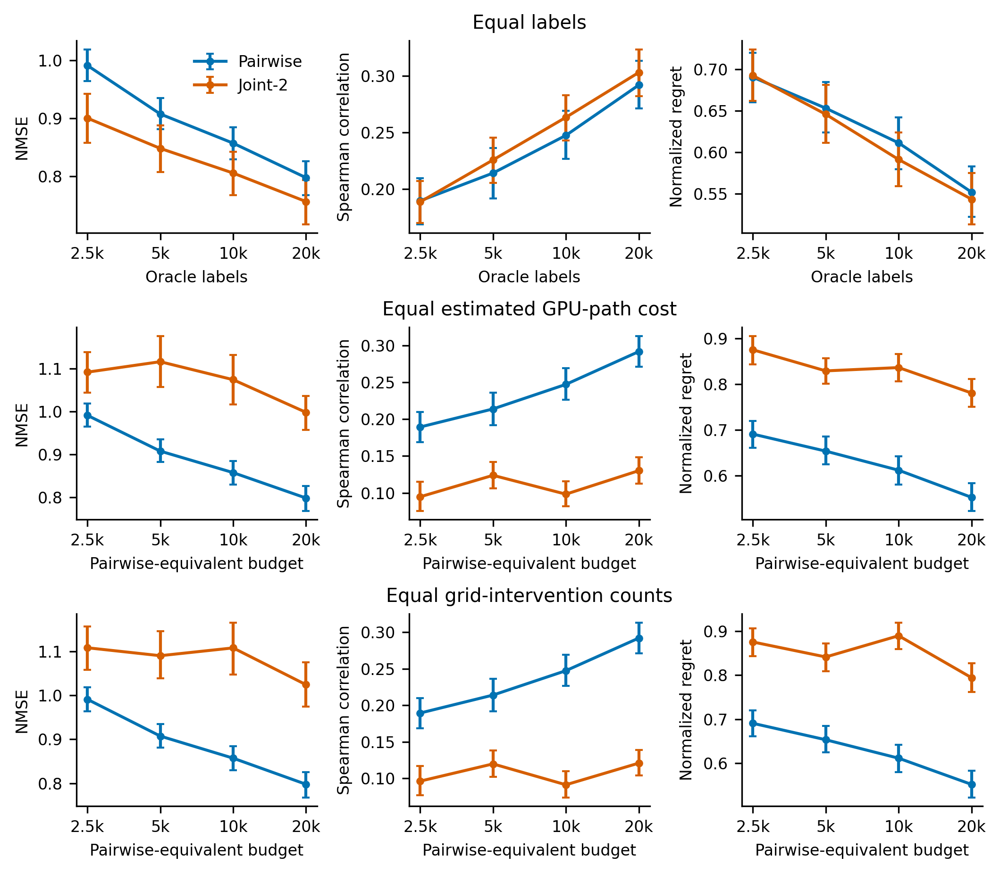
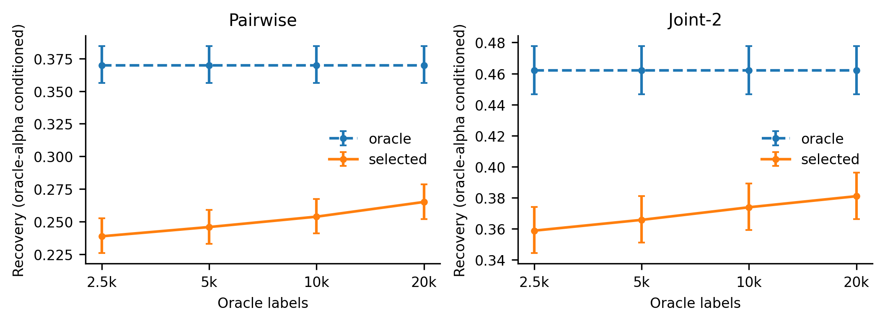

# Pairwise CFS vs Joint-2：可预测性与成本

日期2026-11-16。已完成51个正式拟合、2个短程Pilot；Backbone未训练，原CFS/Routing/Scaling文件未改。主候选池seed42，敏感性123/2027。完整数据与模型保存，未筛选有利结果。

## 科学结论（Q1–Q5）

**Q1：Joint-2有额外Oracle恢复能力。** Pairwise=0.3699 [0.3561, 0.3846]，Joint-2=0.4620 [0.4468, 0.4778]，配对增益=0.0921 [0.0884, 0.0958]。有效Source中增益>1e-6的平均比例为97.53%；输入均值增益>1e-6的样本比例为100.00%。增益按输入分布见Figure1；它不是“Pairwise已穷尽冗余”的证据。

**Q2：测量成本更高，但本轮绝对开销仍可控。** 稳态批量单标签为Pairwise 22.10微秒、Joint-2 493.71微秒，约22.34倍。主候选池48/72个关系，实际每输入测量约1.061/35.547毫秒。不能将组合数、单标签成本、完整空间成本混为一谈，也不称Joint-2不可计算。

**Q3：相同标签数并不支持Joint-2更难预测。** 20k标签下NMSE Pairwise=0.7978 [0.7681, 0.8258]，Joint-2=0.7567 [0.7178, 0.7941]；Joint-2更低。Spearman差与归一化Regret差的区间见配对表，不能用4/6候选的原始命中率直接比较难度。匹配估算GPU路径时间或严格网格干预点数后，Pairwise预测质量更好。这是有限架构/训练协议下的测量预算效率结果，不是联合关系不可学习的定理。

**Q4：额外Oracle能力确实转化为选择收益。** 等20k标签下选中Recovery为0.2652/0.3810；等估算成本时Joint-2为0.3458，严格干预预算时为0.3438，仍高于Pairwise。不能把NMSE较差写成实际Recovery也较差。所有选中Recovery均使用该输入该候选的Oracle Alpha，没有Alpha Predictor，**不是完整forward-only部署收益**。

等标签的“选中增益/Oracle增益”可能大于1：这是两个方法各自选择Regret不同导致的比值，不是有界的额外能力利用百分比。原始比值和CI保留在paired.csv，不裁剪或解读成超过100%的物理恢复。

**Q5：支持更紧凑、便宜的基础关系，不支持Pairwise全面占优。** 真Pairwise分数的小模型可以很好近似Joint-2标签，但使用测试时Oracle信息，不能视作免费部署。更实用的预测Pairwise分数均值，在相同20k标签下获得Joint-2选择Recovery 0.3797，直接Joint-2为0.3810，直接减聚合的配对差0.0013 [-0.0019, 0.0042]；区间跨零不证明等效。二者最终仍依赖Joint-2 Oracle Alpha。成本高不等于科学价值低。

## 主结果与学习曲线

表中cost是相同**估算的摊销后缀GPU路径时间**；evaluations严格匹配标签网格干预次数（仅整数取整有<1%差异），不是相同墙钟时间。pair行在两类预算对照中共用。

| method   | curve       |   budget |   labels |     nmse |   normalized_regret |   oracle |   selected |   spearman |
|:---------|:------------|---------:|---------:|---------:|--------------------:|---------:|-----------:|-----------:|
| joint    | cost        |     2500 |      111 | 1.091597 |            0.875334 | 0.461965 |   0.331669 |   0.094658 |
| joint    | cost        |     5000 |      223 | 1.115992 |            0.829109 | 0.461965 |   0.338550 |   0.123819 |
| joint    | cost        |    10000 |      447 | 1.074005 |            0.836365 | 0.461965 |   0.337470 |   0.098207 |
| joint    | cost        |    20000 |      895 | 0.997797 |            0.780680 | 0.461965 |   0.345759 |   0.130131 |
| joint    | evaluations |     2500 |       80 | 1.107905 |            0.875070 | 0.461965 |   0.331709 |   0.096345 |
| joint    | evaluations |     5000 |      161 | 1.089884 |            0.841106 | 0.461965 |   0.336764 |   0.119932 |
| joint    | evaluations |    10000 |      322 | 1.107590 |            0.889257 | 0.461965 |   0.329597 |   0.091378 |
| joint    | evaluations |    20000 |      645 | 1.024060 |            0.794129 | 0.461965 |   0.343757 |   0.120975 |
| joint    | labels      |     2500 |     2500 | 0.900248 |            0.692677 | 0.461965 |   0.358858 |   0.188461 |
| joint    | labels      |     5000 |     5000 | 0.848179 |            0.646027 | 0.461965 |   0.365802 |   0.225622 |
| joint    | labels      |    10000 |    10000 | 0.805769 |            0.591519 | 0.461965 |   0.373916 |   0.263325 |
| joint    | labels      |    20000 |    20000 | 0.756749 |            0.543717 | 0.461965 |   0.381031 |   0.303025 |
| pair     | labels      |     2500 |     2500 | 0.990846 |            0.690676 | 0.369870 |   0.238898 |   0.189441 |
| pair     | labels      |     5000 |     5000 | 0.907340 |            0.653358 | 0.369870 |   0.245975 |   0.214001 |
| pair     | labels      |    10000 |    10000 | 0.857146 |            0.611537 | 0.369870 |   0.253905 |   0.247349 |
| pair     | labels      |    20000 |    20000 | 0.797833 |            0.552164 | 0.369870 |   0.265164 |   0.291911 |





图均提供PDF。完整Mean/CI/输入SD/seed SD见summary.csv；逐seed见per_seed.csv；所有逐输入记录见per_input.csv/json。命中率/Top2 Recall之外同时提供random基线和chance-adjusted指标。

### 主池20k预算的配对比较

Joint2减Pairwise；NMSE与Regret越低越好，Recovery/Spearman越高越好。

|   pool |   budget | curve       | metric               | contrast                       |      mean |    ci_low |   ci_high |   sd_inputs |   n_inputs |
|-------:|---------:|:------------|:---------------------|:-------------------------------|----------:|----------:|----------:|------------:|-----------:|
|     42 |    20000 | labels      | selected             | Joint2_minus_Pairwise          |  0.115867 |  0.110300 |  0.121671 |    0.047259 |        256 |
|     42 |    20000 | labels      | regret               | Joint2_minus_Pairwise          | -0.023773 | -0.028928 | -0.019258 |    0.039383 |        256 |
|     42 |    20000 | labels      | spearman             | Joint2_minus_Pairwise          |  0.011114 | -0.003487 |  0.026312 |    0.122203 |        256 |
|     42 |    20000 | labels      | best_hit             | Joint2_minus_Pairwise          | -0.138050 | -0.157447 | -0.118944 |    0.154003 |        256 |
|     42 |    20000 | labels      | top2_recall          | Joint2_minus_Pairwise          | -0.153130 | -0.164509 | -0.141110 |    0.096115 |        256 |
|     42 |    20000 | labels      | nmse                 | Joint2_minus_Pairwise          | -0.041084 | -0.061375 | -0.021506 |  nan        |        256 |
|     42 |    20000 | labels      | normalized_regret    | Joint2_minus_Pairwise          | -0.008447 | -0.033407 |  0.016055 |  nan        |        256 |
|     42 |    20000 | labels      | chance_adjusted_hit  | Joint2_minus_Pairwise          | -0.099219 | -0.122716 | -0.075060 |  nan        |        256 |
|     42 |    20000 | labels      | chance_adjusted_top2 | Joint2_minus_Pairwise          | -0.040795 | -0.061348 | -0.019779 |  nan        |        256 |
|     42 |    20000 | labels      | realized_gain_ratio  | selected_gain_over_oracle_gain |  1.258135 |  1.206449 |  1.316156 |  nan        |        256 |
|     42 |    20000 | cost        | selected             | Joint2_minus_Pairwise          |  0.080595 |  0.074319 |  0.086994 |    0.050227 |        256 |
|     42 |    20000 | cost        | regret               | Joint2_minus_Pairwise          |  0.011500 |  0.006059 |  0.016757 |    0.043694 |        256 |
|     42 |    20000 | cost        | spearman             | Joint2_minus_Pairwise          | -0.161780 | -0.182733 | -0.140745 |    0.165138 |        256 |
|     42 |    20000 | cost        | best_hit             | Joint2_minus_Pairwise          | -0.227022 | -0.244249 | -0.209255 |    0.143145 |        256 |
|     42 |    20000 | cost        | top2_recall          | Joint2_minus_Pairwise          | -0.235993 | -0.248212 | -0.223851 |    0.100176 |        256 |
|     42 |    20000 | cost        | nmse                 | Joint2_minus_Pairwise          |  0.199964 |  0.159313 |  0.238049 |  nan        |        256 |
|     42 |    20000 | cost        | normalized_regret    | Joint2_minus_Pairwise          |  0.228516 |  0.197386 |  0.258603 |  nan        |        256 |
|     42 |    20000 | cost        | chance_adjusted_hit  | Joint2_minus_Pairwise          | -0.207195 | -0.228900 | -0.184178 |  nan        |        256 |
|     42 |    20000 | cost        | chance_adjusted_top2 | Joint2_minus_Pairwise          | -0.165090 | -0.186998 | -0.143178 |  nan        |        256 |
|     42 |    20000 | cost        | realized_gain_ratio  | selected_gain_over_oracle_gain |  0.875132 |  0.818966 |  0.935200 |  nan        |        256 |
|     42 |    20000 | evaluations | selected             | Joint2_minus_Pairwise          |  0.078593 |  0.072318 |  0.085094 |    0.051760 |        256 |
|     42 |    20000 | evaluations | regret               | Joint2_minus_Pairwise          |  0.013502 |  0.007308 |  0.019294 |    0.048549 |        256 |
|     42 |    20000 | evaluations | spearman             | Joint2_minus_Pairwise          | -0.170936 | -0.192435 | -0.150957 |    0.168018 |        256 |
|     42 |    20000 | evaluations | best_hit             | Joint2_minus_Pairwise          | -0.226079 | -0.243852 | -0.207114 |    0.151520 |        256 |
|     42 |    20000 | evaluations | top2_recall          | Joint2_minus_Pairwise          | -0.236008 | -0.247742 | -0.223737 |    0.099756 |        256 |
|     42 |    20000 | evaluations | nmse                 | Joint2_minus_Pairwise          |  0.226227 |  0.179059 |  0.270779 |  nan        |        256 |
|     42 |    20000 | evaluations | normalized_regret    | Joint2_minus_Pairwise          |  0.241965 |  0.210034 |  0.272832 |  nan        |        256 |
|     42 |    20000 | evaluations | chance_adjusted_hit  | Joint2_minus_Pairwise          | -0.206050 | -0.228510 | -0.181648 |  nan        |        256 |
|     42 |    20000 | evaluations | chance_adjusted_top2 | Joint2_minus_Pairwise          | -0.165111 | -0.186579 | -0.142678 |  nan        |        256 |
|     42 |    20000 | evaluations | realized_gain_ratio  | selected_gain_over_oracle_gain |  0.853395 |  0.790303 |  0.920194 |  nan        |        256 |

### Pairwise信息能解释多少联合关系？

oracle_pair_max/mean与pair_info使用**真实Pairwise Oracle分数**，是有额外测量成本的信息诊断。pair_info为1185参数对称MLP，同20k Joint标签、3seed；输入为两条Pairwise分数的均值和绝对差。predicted_pair_max/mean仅使用Pairwise预测器的输出，未用Joint标签拟合选择规则。max、mean事先同时报告，没有测试后挑选。NMSE差异与排序差异分别看：未校准的mean可能MSE很差而排序仍好。

| method              |     nmse |   normalized_regret |   selected |   spearman |
|:--------------------|---------:|--------------------:|-----------:|-----------:|
| oracle_pair_max     | 0.094574 |            0.309575 |   0.415884 |   0.821678 |
| oracle_pair_mean    | 0.494223 |            0.170341 |   0.436609 |   0.822235 |
| pair_info           | 0.054846 |            0.170341 |   0.436609 |   0.831033 |
| predicted_pair_max  | 0.912177 |            0.705400 |   0.356965 |   0.279773 |
| predicted_pair_mean | 1.102552 |            0.552358 |   0.379745 |   0.300308 |

|   pool |   budget | metric   | contrast                               |      mean |    ci_low |   ci_high |   sd_inputs |   n_inputs |
|-------:|---------:|:---------|:---------------------------------------|----------:|----------:|----------:|------------:|-----------:|
|     42 |    20000 | selected | direct_joint_minus_predicted_pair_max  |  0.024067 |  0.019261 |  0.028956 |    0.039014 |        256 |
|     42 |    20000 | regret   | direct_joint_minus_predicted_pair_max  | -0.024067 | -0.028956 | -0.019261 |    0.039014 |        256 |
|     42 |    20000 | spearman | direct_joint_minus_predicted_pair_max  |  0.023253 |  0.010907 |  0.035737 |    0.104445 |        256 |
|     42 |    20000 | selected | direct_joint_minus_predicted_pair_mean |  0.001286 | -0.001858 |  0.004219 |    0.024976 |        256 |
|     42 |    20000 | regret   | direct_joint_minus_predicted_pair_mean | -0.001286 | -0.004219 |  0.001858 |    0.024976 |        256 |
|     42 |    20000 | spearman | direct_joint_minus_predicted_pair_mean |  0.002717 | -0.008855 |  0.013679 |    0.093278 |        256 |

## 定义、原实现与正确性

复用src/head_intervention.py、model_loading.py、runtime_cfs_router.prehead_summary及原dense_kl。z'=z-c_i+(alpha_j-1)c_j+(alpha_k-1)c_k；alpha=1不改变替代Head，alpha=0删除该Head。Bias只计一次，不改其他贡献、LayerNorm或后续MLP。只删除一个Source。CFS=1-Dreplacement/max(Ddrop,1e-12)，D为温度1的KL(dense||intervened)，clamp_min0保持原实现；Ddrop>1e-5有效。先在有效Source内均值，再按独立输入统计。真实标签未额外裁剪。

原ViT-B AugReg `vit_base_patch16_224.augreg_in21k_ft_in1k`、原checkpoint与timm预处理；层11、12头。最后层后CLS不再与Patch交换信息，因此可缓存CLS Attention输入/融合Head输出，只重算投影、残差、MLP、Norm和分类Head。直接Forward与缓存后缀的无干预、单头删除、双缩放均数值一致；全部Joint候选都包含其两个Pairwise可行解。72项本地测试及4项生产环境新测试通过；verification.json记录全部审计。

本轮统一FP32、关闭TF32。旧Pairwise训练缓存是16点/FP16，旧Joint-Subset缓存是多头硬删除，均不能当作本轮统一31点缩放标签；复用了权重、划分、预处理及代码，必要部分重新测量。两方法没有精度差异。

### Alpha优化Benchmark

8训练输入比较完整31x31网格、从(1,1)梯度初始化、最佳Pairwise初始化、3起点60/120步。约束[0,3]，投影Adam lr0.08，逐步保留最好值。网格每标签31/961个候选，最大batch1024，前后向调用数见表。梯度方法连续可行域比分立网格更密，负excess表示其KL更小，不代表网格求解失败。网格更快，且对**原31点离散域**精确，所以选用网格而非近似优化；原有Pairwise可行解也保留，避免微小batch浮点噪声破坏包含性质。

以下排除首次setup调用，报告中位数；全部冷/热记录保留在benchmark/costs.csv。max_recovery_excess列在此为每输入最大值的中位数，原始逐输入最大误差可直接核对，不冒称全局最大值。

| method            |   seconds |   seconds_per_label |     variants |   forward_calls |   backward_calls |   mean_recovery_excess |   max_recovery_excess |
|:------------------|----------:|--------------------:|-------------:|----------------:|-----------------:|-----------------------:|----------------------:|
| gradient_multi120 |  0.148125 |            0.002057 | 26136.000000 |      121.000000 |       120.000000 |              -0.005022 |             -0.000030 |
| gradient_multi60  |  0.073612 |            0.001022 | 13176.000000 |       61.000000 |        60.000000 |              -0.004944 |              0.000004 |
| gradient_ones60   |  0.075302 |            0.001046 |  4392.000000 |       61.000000 |        60.000000 |              -0.004648 |              0.000324 |
| gradient_pair60   |  0.074385 |            0.001033 |  4392.000000 |       61.000000 |        60.000000 |              -0.004725 |              0.000132 |
| joint_grid31x31   |  0.035547 |            0.000494 | 69192.000000 |       68.000000 |         0.000000 |               0.000000 |              0.000000 |
| joint_serial_one  |  0.000775 |            0.000775 |   961.000000 |        1.000000 |         0.000000 |             nan        |            nan        |
| pair_grid31       |  0.001061 |            0.000022 |  1488.000000 |        2.000000 |         0.000000 |             nan        |            nan        |
| pair_serial_one   |  0.000575 |            0.000575 |    31.000000 |        1.000000 |         0.000000 |             nan        |            nan        |

预定32测试输入上，两种方法都进一步连续优化；平均结果如下，仅作精度敏感性，不重新训练或选择主方案：

| index            |     mean |
|:-----------------|---------:|
| pair_grid        | 0.405333 |
| joint_grid       | 0.503176 |
| pair_continuous  | 0.411951 |
| joint_continuous | 0.511355 |
| grid_gain        | 0.097844 |
| continuous_gain  | 0.099404 |

## 实测成本、完整关系空间与预测开销

GPU Event与同步墙钟计时（同一GPU、warm-up后8训练输入各3重复）：

| kind   |   wall_seconds |   gpu_event_seconds |
|:-------|---------------:|--------------------:|
| joint  |       0.035574 |            0.035558 |
| pair   |       0.001069 |            0.001053 |

H=12完整132/660关系空间也实测，以下为输入1–3的稳态中位数；input0冷启动另保留：

| kind   |   relations |   seconds |   gpu_event_seconds |
|:-------|------------:|----------:|--------------------:|
| joint  |  660.000000 |  0.323322 |            0.323301 |
| pair   |  132.000000 |  0.002482 |            0.002447 |

H=40只报告组合数1560/29640，以及固定ViT单位成本的情景投影，**没有测量40头模型**，也不假设其宽度/吞吐相同。见relation_complexity.csv。完整标签采集各阶段墙钟时间（含缓存保存）如下；它不同于单标签摊销模型：

| pool     | split   |   inputs |   seconds |
|:---------|:--------|---------:|----------:|
| pool123  | test    |      256 | 12.496700 |
| pool2027 | test    |      256 | 12.504920 |
| pool42   | test    |      256 | 12.550312 |
| pool42   | train   |     1024 | 49.728396 |
| pool42   | tune    |       64 |  3.417892 |

累计测量区间秒数：{'capture_seconds': 6.35191680351263, 'drop_seconds': 1.0586681184357953, 'pair_seconds': 2.1957726092076877, 'joint_seconds': 66.21867887908584}。这些阶段只运行一次，学习曲线离线抽取标签；不能将子集预算估算假称实际重复收集总时间。公平成本控制不包含共同的Dense捕获/Source-drop固定缓存，均单列。

预测成本，单关系与完整池分开。参数量完全相同，权重文件包括少量归一化元数据。FLOPs是Linear乘加按2 FLOPs计算，含一次共享global encoder，不含非线性、embedding查表、归一化和Backbone；不是完整模型FLOPs。实际延迟中两个完整池接近，不能仅按48/72关系数宣称1.5倍实测延迟。

| kind   | scope           |   relations |   parameters |   weight_bytes |   median_seconds |   mean_seconds |   dense_linear_flops | flops_scope                                                                                   | includes_backbone   |
|:-------|:----------------|------------:|-------------:|---------------:|-----------------:|---------------:|---------------------:|:----------------------------------------------------------------------------------------------|:--------------------|
| pair   | single_relation |           1 |       668801 |        2704945 |         0.000141 |       0.000142 |              1335808 | linear MAC=2 FLOPs, global encoder shared; excludes activations, embeddings and normalization | False               |
| pair   | complete_pool   |          48 |       668801 |        2704945 |         0.000154 |       0.000156 |              8675328 | linear MAC=2 FLOPs, global encoder shared; excludes activations, embeddings and normalization | False               |
| joint  | single_relation |           1 |       668801 |        2704945 |         0.000142 |       0.000143 |              1335808 | linear MAC=2 FLOPs, global encoder shared; excludes activations, embeddings and normalization | False               |
| joint  | complete_pool   |          72 |       668801 |        2704945 |         0.000154 |       0.000155 |             12423168 | linear MAC=2 FLOPs, global encoder shared; excludes activations, embeddings and normalization | False               |

## 数据、训练预算与统计限制

1024训练图来自原4096训练划分，验证64沿用原划分，新测试256排除原4608与后续确认256，按路径和内容SHA检查。排除的是本路由实验系列，不声称公共图像在全部历史研究从未出现。候选池由seed42均匀无放回采样，每Source四个，固定且与标签无关。

PairScorePredictor level0仅提供预Attention2304维特征。为Joint无序集合加入candidate embedding均值/绝对差，两个模型完全相同668801参数；singleton用重复candidate。原PairScore只优化排序，本研究为校准CFS回归采用**相同标准化MSE**，不能称原训练损失完全没变。目标均值/方差来自该预算训练标签；原始输出保留，预测越界比例明确报告。两者共享全部训练特征的无标签归一化统计。AdamW3e-4、decay1e-4、batch128、2000步；每250步验证MSE选模型，三个seed17/23/41，无超参搜索。每种预算不同的独立训练输入数也保留：

| kind      | curve       |   nominal_budget |   labels |   unique_training_inputs |   parameters |   steps |
|:----------|:------------|-----------------:|---------:|-------------------------:|-------------:|--------:|
| joint     | cost        |             2500 |      111 |                      105 |       668801 |    2000 |
| joint     | cost        |             5000 |      223 |                      200 |       668801 |    2000 |
| joint     | cost        |            10000 |      447 |                      358 |       668801 |    2000 |
| joint     | cost        |            20000 |      895 |                      598 |       668801 |    2000 |
| joint     | evaluations |             2500 |       80 |                       77 |       668801 |    2000 |
| joint     | evaluations |             5000 |      161 |                      148 |       668801 |    2000 |
| joint     | evaluations |            10000 |      322 |                      272 |       668801 |    2000 |
| joint     | evaluations |            20000 |      645 |                      478 |       668801 |    2000 |
| joint     | labels      |             2500 |     2500 |                      939 |       668801 |    2000 |
| joint     | labels      |             5000 |     5000 |                     1021 |       668801 |    2000 |
| joint     | labels      |            10000 |    10000 |                     1024 |       668801 |    2000 |
| joint     | labels      |            20000 |    20000 |                     1024 |       668801 |    2000 |
| pair      | labels      |             2500 |     2500 |                      933 |       668801 |    2000 |
| pair      | labels      |             5000 |     5000 |                     1020 |       668801 |    2000 |
| pair      | labels      |            10000 |    10000 |                     1024 |       668801 |    2000 |
| pair      | labels      |            20000 |    20000 |                     1024 |       668801 |    2000 |
| pair_info | information |            20000 |    20000 |                     1024 |         1185 |    2000 |

39个主模型在生成测试Teacher前锁定；额外12个严格干预次数对照在主测试程序启动之后、**人工查看测试指标之前**声明，仍仅用训练/验证选择，并单独锁定。COALITIONAL_COST_CONTROL_AMENDMENT.md完整记录；不把所有51个模型都说成测试标签产生前锁定。

2000次Bootstrap按独立输入，共享配对索引，先在输入内平均3seed。NMSE是aggregate MSE/训练常数在测试上的MSE，非每输入比值再均值。Normalized Regret用对应随机选择Regret归一化；最佳候选命中处理真实最优的数值并列；Top2用稳定排序。候选分数完全平坦时Spearman记0并报告比例。多预算/指标/候选池为探索性分析，未多重校正。seed CI条件于这三个训练seed，不把seed作为额外输入。

候选池123/2027仅对相同固定预测器评估，候选身份可能包含训练池之外的关系；这是候选池敏感性/组合外推，不能把它说成每池都独立训练后的学习效率。

|   pool |   threshold | metric               |     mean |   ci_low |   ci_high |   sd_inputs |   n_inputs |
|-------:|------------:|:---------------------|---------:|---------:|----------:|------------:|-----------:|
|     42 |    0.000010 | pair_oracle          | 0.369870 | 0.356129 |  0.384556 |    0.123155 |        256 |
|     42 |    0.000010 | joint_oracle         | 0.461965 | 0.446781 |  0.477764 |    0.131089 |        256 |
|     42 |    0.000010 | oracle_gain          | 0.092094 | 0.088449 |  0.095784 |    0.030468 |        256 |
|     42 |    0.000010 | source_gain_fraction | 0.975272 | 0.969934 |  0.980292 |    0.042849 |        256 |
|     42 |    0.000010 | input_gain_fraction  | 1.000000 | 1.000000 |  1.000000 |    0.000000 |        256 |
|    123 |    0.000010 | pair_oracle          | 0.361667 | 0.347259 |  0.377420 |    0.129369 |        256 |
|    123 |    0.000010 | joint_oracle         | 0.443988 | 0.428468 |  0.460691 |    0.138268 |        256 |
|    123 |    0.000010 | oracle_gain          | 0.082321 | 0.078863 |  0.085844 |    0.028387 |        256 |
|    123 |    0.000010 | source_gain_fraction | 0.964441 | 0.957931 |  0.970882 |    0.053326 |        256 |
|    123 |    0.000010 | input_gain_fraction  | 1.000000 | 1.000000 |  1.000000 |    0.000000 |        256 |
|   2027 |    0.000010 | pair_oracle          | 0.345155 | 0.330566 |  0.360173 |    0.127216 |        256 |
|   2027 |    0.000010 | joint_oracle         | 0.433554 | 0.417958 |  0.449315 |    0.135877 |        256 |
|   2027 |    0.000010 | oracle_gain          | 0.088399 | 0.084711 |  0.091903 |    0.029746 |        256 |
|   2027 |    0.000010 | source_gain_fraction | 0.963920 | 0.957704 |  0.970496 |    0.051604 |        256 |
|   2027 |    0.000010 | input_gain_fraction  | 1.000000 | 1.000000 |  1.000000 |    0.000000 |        256 |

各池20k等标签预测结果（固定同一批模型）：

|   pool | method   | metric            |     mean |   ci_low |   ci_high |
|-------:|:---------|:------------------|---------:|---------:|----------:|
|     42 | joint    | selected          | 0.381031 | 0.366384 |  0.396147 |
|     42 | joint    | spearman          | 0.303025 | 0.282022 |  0.323563 |
|     42 | joint    | nmse              | 0.756749 | 0.717833 |  0.794082 |
|     42 | joint    | normalized_regret | 0.543717 | 0.513567 |  0.575179 |
|     42 | pair     | selected          | 0.265164 | 0.251902 |  0.278692 |
|     42 | pair     | spearman          | 0.291911 | 0.271033 |  0.313239 |
|     42 | pair     | nmse              | 0.797833 | 0.768057 |  0.825781 |
|     42 | pair     | normalized_regret | 0.552164 | 0.522692 |  0.583041 |
|    123 | joint    | selected          | 0.339527 | 0.323810 |  0.355680 |
|    123 | joint    | spearman          | 0.146591 | 0.127376 |  0.165056 |
|    123 | joint    | nmse              | 0.927009 | 0.887173 |  0.965634 |
|    123 | joint    | normalized_regret | 0.763835 | 0.733634 |  0.792056 |
|    123 | pair     | selected          | 0.221154 | 0.207176 |  0.235942 |
|    123 | pair     | spearman          | 0.154961 | 0.133385 |  0.177139 |
|    123 | pair     | nmse              | 0.929364 | 0.901507 |  0.959802 |
|    123 | pair     | normalized_regret | 0.772975 | 0.740462 |  0.806912 |
|   2027 | joint    | selected          | 0.321457 | 0.307080 |  0.337131 |
|   2027 | joint    | spearman          | 0.127790 | 0.107619 |  0.148310 |
|   2027 | joint    | nmse              | 0.967077 | 0.930547 |  1.003544 |
|   2027 | joint    | normalized_regret | 0.800368 | 0.767084 |  0.833480 |
|   2027 | pair     | selected          | 0.206173 | 0.192976 |  0.220304 |
|   2027 | pair     | spearman          | 0.135690 | 0.114118 |  0.158216 |
|   2027 | pair     | nmse              | 0.966433 | 0.941062 |  0.991883 |
|   2027 | pair     | normalized_regret | 0.790641 | 0.754789 |  0.828962 |

删除阈值敏感性（主定义仍1e-5）：

|        pool |   threshold |   valid_fraction |   inputs_with_no_valid_sources |   minimum_drop |   median_drop |
|------------:|------------:|-----------------:|-------------------------------:|---------------:|--------------:|
|   42.000000 |    0.000010 |         0.973958 |                       0.000000 |       0.000001 |      0.001556 |
|   42.000000 |    0.000100 |         0.853516 |                       0.000000 |       0.000001 |      0.001556 |
|   42.000000 |    0.001000 |         0.566406 |                      13.000000 |       0.000001 |      0.001556 |
|  123.000000 |    0.000010 |         0.973958 |                       0.000000 |       0.000001 |      0.001556 |
|  123.000000 |    0.000100 |         0.853516 |                       0.000000 |       0.000001 |      0.001556 |
|  123.000000 |    0.001000 |         0.566406 |                      13.000000 |       0.000001 |      0.001556 |
| 2027.000000 |    0.000010 |         0.973958 |                       0.000000 |       0.000001 |      0.001556 |
| 2027.000000 |    0.000100 |         0.853516 |                       0.000000 |       0.000001 |      0.001556 |
| 2027.000000 |    0.001000 |         0.566406 |                      13.000000 |       0.000001 |      0.001556 |

全部1e-4/1e-3阈值的Oracle结果也在oracle.csv；不把弱删除样本静默移除。没有有效Source的输入只在对应阈值统计中排除，n_inputs及逐输入记录均保存。

## 复现与交付

独立目录`/data/cfs_coalitional_20261116`，保留源代码、images/data、教师、全部训练权重/日志。原Backbone路径由benchmark_coalitional_cfs.load读取，可按环境映射到同SHA文件。执行环境见environment.json。不要覆盖历史输出。

```bash
export CUBLAS_WORKSPACE_CONFIG=:4096:8 OPENBLAS_NUM_THREADS=4
# 准备RUN/data, images和manifest；prepare_coalitional_cfs.py提供完整CLI
python scripts/benchmark_coalitional_cfs.py --root RUN
python scripts/collect_coalitional_cfs.py --root RUN --split train
python scripts/collect_coalitional_cfs.py --root RUN --split tune
python scripts/train_coalitional_cfs.py --root RUN --pilot
# 两个worker可分别绑定GPU0/1，先完成主模型
python scripts/train_coalitional_cfs.py --root RUN --worker 0 --workers 2
python scripts/train_coalitional_cfs.py --root RUN --worker 1 --workers 2
python scripts/lock_coalitional_cfs.py --root RUN
# 补充严格预算对照，两worker均增加--evaluation-budget，再独立lock
python scripts/train_coalitional_cfs.py --root RUN --worker 0 --workers 2 --evaluation-budget
python scripts/train_coalitional_cfs.py --root RUN --worker 1 --workers 2 --evaluation-budget
python scripts/lock_coalitional_cfs.py --root RUN --evaluation-budget
for pool in 42 123 2027; do
  python scripts/collect_coalitional_cfs.py --root RUN --split test --pool-seed $pool
  python scripts/evaluate_coalitional_cfs.py --root RUN --pool-seed $pool
done
python scripts/evaluate_coalitional_cfs.py --root RUN --evaluation-budget
python scripts/profile_coalitional_cfs.py --root RUN
python scripts/benchmark_coalitional_fullspace.py --root RUN
python scripts/verify_coalitional_cfs.py --root RUN
python scripts/analyze_coalitional_cfs.py --root RUN --output RUN/analysis
python scripts/report_coalitional_cfs.py --root RUN
```

新增文件均以coalitional命名：src下干预/预测器与输入级指标；scripts下prepare/benchmark/collect/train/lock/evaluate/profile/verify/analyze/report；tests下数值与统计测试。没有改原模型、路由或Scaling脚本。原始teacher与完整权重见ARTIFACTS.md，不只交付最终均值。

## Reviewer nLkz draft

Pairwise CFS and coalitional reconstruction measure different levels of redundancy. We evaluated the natural Joint-2 extension on the same frozen ViT-B block, using an identical label-independent four-head candidate pool per source, output KL, valid-deletion rule and alpha domain. Exact 31-point/31-by-31 grid searches gave Pairwise recovery 0.3699 and Joint-2 recovery 0.4620; the paired gain was 0.0921 [0.0884, 0.0958] (95% input-bootstrap CI). Joint-2 therefore captures additional redundancy that the pairwise definition intentionally does not exhaust.

The relation space grows from 132 to 660 relations for 12 heads (1,560 to 29,640 for 40 heads). On our cached ViT suffix, Joint-2 labels cost approximately 22.3 times more per label in steady-state batched measurement; these are measured implementation costs, not a universal complexity constant. Both tasks used 668,801-parameter predictors and three fixed training seeds. At 20,000 labels, Joint-2 had lower NMSE (0.757 vs 0.798), with no clear normalized-regret difference. Thus we do not claim that coalitional relations are inherently harder to predict. Under estimated equal measurement cost and independently matched intervention-count budgets, Joint-2 prediction quality deteriorated, although its selected recovery still exceeded Pairwise recovery.

A simple mean of predicted Pairwise scores selected Joint-2 coalitions with recovery 0.3797, versus 0.3810 for the direct Joint-2 predictor; their paired difference was 0.0013 [-0.0019, 0.0042]. This suggests a useful compact basis for coalition selection, not equivalence or absence of higher-order information. All selected-recovery comparisons remain conditioned on input-specific oracle coefficients; they do not establish deployable forward-only compensation or acceleration. These exploratory, non-multiplicity-adjusted results support Pairwise CFS as a cheaper, interpretable primitive, while recognizing Joint-2 as a valuable extension rather than a scientifically inferior alternative.
