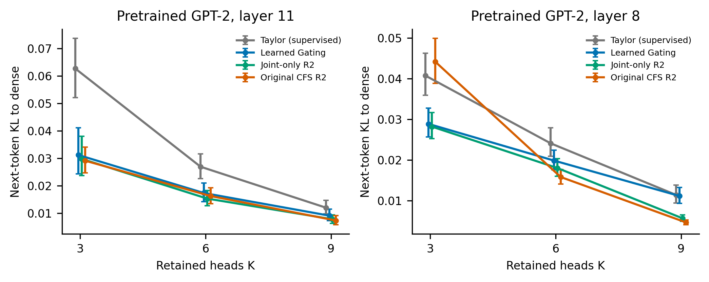

# Cross-model CFS Dynamic Routing: pretrained GPT-2

日期：2026-11-15。模型openai-community/gpt2，revision `607a30d783dfa663caf39e06633721c8d4cfcd7e`，124,439,808参数；实际Config12层/12头/768宽。Backbone完全冻结。完成层：[11, 8]，每层独立训练Router与Teacher。主方法始终为原始R2，未根据测试结果改用A3或其他方法。

本轮支持**有条件的跨模型、跨层路由价值**。Layer11的R2三个预算均值均低于Taylor/Gating，但相对Gating只有K=9的配对区间完全低于零；相对A0三个预算均跨零。Layer8在K=6、9相对Gating和A0均有区间支持的改善，却在K=3明确差于两者。因此，额外CFS监督的收益依赖层与预算，不能总结为普遍优于学习门控。

辅助任务指标须另看NLL配对表；低KL不等于提升真实下一Token预测质量。

## 主结果：真实Hard Gating Output KL

越低越好；平均三个固定训练seed17/23/41。Taylor是使用真实下一Token标签的梯度分析基线，不是无标签前向生成方法。

|   layer | method   |        3 |        6 |        9 |
|--------:|:---------|---------:|---------:|---------:|
|      11 | A0       | 0.029741 | 0.015308 | 0.007769 |
|      11 | Gating   | 0.031157 | 0.017331 | 0.009095 |
|      11 | R2       | 0.029095 | 0.016237 | 0.007316 |
|      11 | Taylor   | 0.062677 | 0.026910 | 0.012000 |
|       8 | A0       | 0.028166 | 0.018003 | 0.005630 |
|       8 | Gating   | 0.028834 | 0.019835 | 0.011146 |
|       8 | R2       | 0.044117 | 0.015795 | 0.004632 |
|       8 | Taylor   | 0.040728 | 0.024075 | 0.011403 |



[矢量PDF](figure_routing_kl.pdf)。A0表示Joint-only R2；两层均为0-based索引。

完整KL与95%区间：

|   layer | method   |   keep |     mean |   ci_low |   ci_high |
|--------:|:---------|-------:|---------:|---------:|----------:|
|       8 | A0       |      3 | 0.028166 | 0.025226 |  0.031625 |
|       8 | A0       |      6 | 0.018003 | 0.015991 |  0.020350 |
|       8 | A0       |      9 | 0.005630 | 0.004891 |  0.006460 |
|       8 | Gating   |      3 | 0.028834 | 0.025632 |  0.032714 |
|       8 | Gating   |      6 | 0.019835 | 0.017559 |  0.022381 |
|       8 | Gating   |      9 | 0.011146 | 0.009289 |  0.013263 |
|       8 | R2       |      3 | 0.044117 | 0.038830 |  0.049841 |
|       8 | R2       |      6 | 0.015795 | 0.014064 |  0.017662 |
|       8 | R2       |      9 | 0.004632 | 0.004096 |  0.005248 |
|       8 | Taylor   |      3 | 0.040728 | 0.035851 |  0.046187 |
|       8 | Taylor   |      6 | 0.024075 | 0.020865 |  0.027873 |
|       8 | Taylor   |      9 | 0.011403 | 0.009378 |  0.013792 |
|      11 | A0       |      3 | 0.029741 | 0.023657 |  0.038050 |
|      11 | A0       |      6 | 0.015308 | 0.012695 |  0.018266 |
|      11 | A0       |      9 | 0.007769 | 0.006339 |  0.009350 |
|      11 | Gating   |      3 | 0.031157 | 0.024286 |  0.041134 |
|      11 | Gating   |      6 | 0.017331 | 0.014137 |  0.021019 |
|      11 | Gating   |      9 | 0.009095 | 0.007218 |  0.011410 |
|      11 | R2       |      3 | 0.029095 | 0.024719 |  0.033997 |
|      11 | R2       |      6 | 0.016237 | 0.013458 |  0.019241 |
|      11 | R2       |      9 | 0.007316 | 0.005828 |  0.009157 |
|      11 | Taylor   |      3 | 0.062677 | 0.052029 |  0.073606 |
|      11 | Taylor   |      6 | 0.026910 | 0.022619 |  0.031582 |
|      11 | Taylor   |      9 | 0.012000 | 0.009788 |  0.014629 |

### R2减参考方法的配对差

负值有利于R2。区间跨零不表示等效，也不从均值差直接宣称显著优势。

|   layer |   keep | metric   | contrast        |      mean |    ci_low |   ci_high |   sd_inputs |
|--------:|-------:|:---------|:----------------|----------:|----------:|----------:|------------:|
|       8 |      3 | kl       | R2_minus_Taylor |  0.003388 | -0.001532 |  0.008392 |    0.039420 |
|       8 |      3 | kl       | R2_minus_Gating |  0.015282 |  0.011574 |  0.019473 |    0.031297 |
|       8 |      3 | kl       | R2_minus_A0     |  0.015951 |  0.012276 |  0.020197 |    0.031970 |
|       8 |      3 | nll      | R2_minus_Taylor |  0.046336 |  0.011122 |  0.084012 |    0.299027 |
|       8 |      3 | nll      | R2_minus_Gating |  0.036000 |  0.004334 |  0.068378 |    0.263749 |
|       8 |      3 | nll      | R2_minus_A0     |  0.036691 |  0.003230 |  0.072935 |    0.288159 |
|       8 |      6 | kl       | R2_minus_Taylor | -0.008280 | -0.011588 | -0.005339 |    0.024784 |
|       8 |      6 | kl       | R2_minus_Gating | -0.004040 | -0.005927 | -0.002322 |    0.014676 |
|       8 |      6 | kl       | R2_minus_A0     | -0.002208 | -0.003479 | -0.000942 |    0.010593 |
|       8 |      6 | nll      | R2_minus_Taylor |  0.014773 | -0.011067 |  0.044356 |    0.224877 |
|       8 |      6 | nll      | R2_minus_Gating |  0.015111 | -0.013705 |  0.046113 |    0.242778 |
|       8 |      6 | nll      | R2_minus_A0     | -0.002688 | -0.023145 |  0.021559 |    0.180120 |
|       8 |      9 | kl       | R2_minus_Taylor | -0.006771 | -0.009102 | -0.004852 |    0.016730 |
|       8 |      9 | kl       | R2_minus_Gating | -0.006514 | -0.008361 | -0.004972 |    0.013349 |
|       8 |      9 | kl       | R2_minus_A0     | -0.000998 | -0.001667 | -0.000376 |    0.005225 |
|       8 |      9 | nll      | R2_minus_Taylor | -0.015518 | -0.028725 | -0.003479 |    0.106356 |
|       8 |      9 | nll      | R2_minus_Gating | -0.012017 | -0.030786 |  0.005883 |    0.151632 |
|       8 |      9 | nll      | R2_minus_A0     | -0.009250 | -0.017671 | -0.001855 |    0.063060 |
|      11 |      3 | kl       | R2_minus_Taylor | -0.033582 | -0.042296 | -0.024859 |    0.072077 |
|      11 |      3 | kl       | R2_minus_Gating | -0.002062 | -0.008671 |  0.001903 |    0.045646 |
|      11 |      3 | kl       | R2_minus_A0     | -0.000646 | -0.005613 |  0.002748 |    0.034592 |
|      11 |      3 | nll      | R2_minus_Taylor | -0.034459 | -0.074513 |  0.007301 |    0.325877 |
|      11 |      3 | nll      | R2_minus_Gating |  0.006334 | -0.006495 |  0.020150 |    0.111725 |
|      11 |      3 | nll      | R2_minus_A0     |  0.015038 |  0.000887 |  0.028549 |    0.112778 |
|      11 |      6 | kl       | R2_minus_Taylor | -0.010673 | -0.015030 | -0.006596 |    0.036377 |
|      11 |      6 | kl       | R2_minus_Gating | -0.001093 | -0.002867 |  0.000606 |    0.014421 |
|      11 |      6 | kl       | R2_minus_A0     |  0.000929 | -0.000085 |  0.001962 |    0.008583 |
|      11 |      6 | nll      | R2_minus_Taylor | -0.021428 | -0.051059 |  0.006404 |    0.230612 |
|      11 |      6 | nll      | R2_minus_Gating |  0.004130 | -0.011028 |  0.020251 |    0.126206 |
|      11 |      6 | nll      | R2_minus_A0     |  0.005930 | -0.007361 |  0.019071 |    0.105241 |
|      11 |      9 | kl       | R2_minus_Taylor | -0.004684 | -0.007125 | -0.002400 |    0.018519 |
|      11 |      9 | kl       | R2_minus_Gating | -0.001780 | -0.002984 | -0.000745 |    0.009560 |
|      11 |      9 | kl       | R2_minus_A0     | -0.000453 | -0.001400 |  0.000467 |    0.007528 |
|      11 |      9 | nll      | R2_minus_Taylor |  0.002732 | -0.011129 |  0.016979 |    0.115085 |
|      11 |      9 | nll      | R2_minus_Gating | -0.001300 | -0.012489 |  0.009662 |    0.090788 |
|      11 |      9 | nll      | R2_minus_A0     |  0.011501 | -0.001520 |  0.025502 |    0.114385 |

### 对研究问题的回答

**Q1（可迁移性）**：已将原R2的网络、CFS监督、结构化Utility与精确选择迁移到预训练GPT-2，完成独立训练与真实下一Token Hard Gating；必要的变化是语言前缀特征与固定预测位置。它验证了该协议在语言模型上的可实施性，不是保持原ViT权重的零样本迁移。

**Q2（相对效果）**：以下按输入配对区间逐项判断。区间跨零只表示本实验尚不能明确区分，不表示两者等效。多个预算/层的区间未作多重比较校正。

- Layer 11，R2 vs Taylor：配对KL区间全部低于零的K=[3, 6, 9]；全部高于零的K=[]；跨零的K=[]。
- Layer 11，R2 vs Gating：配对KL区间全部低于零的K=[9]；全部高于零的K=[]；跨零的K=[3, 6]。
- Layer 11，R2 vs A0：配对KL区间全部低于零的K=[]；全部高于零的K=[]；跨零的K=[3, 6, 9]。
- Layer 8，R2 vs Taylor：配对KL区间全部低于零的K=[6, 9]；全部高于零的K=[]；跨零的K=[3]。
- Layer 8，R2 vs Gating：配对KL区间全部低于零的K=[6, 9]；全部高于零的K=[3]；跨零的K=[]。
- Layer 8，R2 vs A0：配对KL区间全部低于零的K=[6, 9]；全部高于零的K=[3]；跨零的K=[]。

**Q3（CFS实际价值）**：跨模型路由行为保持能力应由R2对Taylor/Gating的结果判断；CFS额外监督的增量作用必须另看R2对A0，不能将结构化子集建模与CFS标签的贡献混为一谈。当前实现没有跳过Dense Attention核，不能声称推理加速。数据仅来自一个冻结FineWeb-Edu缓存、256个文档的一个预测位置，不能推广为普遍语言建模质量收益。

**与ViT的关系**：已有[ViT公平对照](../learned_gating_rebuttal_20261115/REPORT.md)中，原R2对Gating的点估计优势集中在K=9；本轮各层的预算依赖性见上述完整结果。仅比较相对模式，不比较不同输出空间的绝对KL，也不将某一预算模式写成跨任务定律。

### Reviewer WCQn: proposed response

We extended the original CFS R2 router to pretrained GPT-2 (124M), independently at layers 11 and 8, without training the backbone. R2, parameter-matched Learned Gating (within 0.3%), and Joint-only R2 used identical causal prefix features and joint-subset teachers. We trained three seeds on 2,048 documents, selected checkpoints on 128 validation documents using actual hard-routing KL, and evaluated 256 held-out documents.

At layer 11, R2 achieved KL 0.02910/0.01624/0.00732 for K=3/6/9, compared with Gating's 0.03116/0.01733/0.00910. R2-minus-Gating's paired 95% CI excluded zero only at K=9: [-0.00298, -0.00075]. At layer 8, R2 achieved 0.04412/0.01580/0.00463. It improved over both Gating and Joint-only R2 at K=6 and K=9, with paired intervals below zero, but performed worse than both at K=3. At layer 11, all R2-versus-Joint-only intervals included zero. R2 outperformed the supervised Taylor baseline at layer 11 and at layer 8's K=6/9; the layer-8 K=3 comparison was inconclusive.

These results extend routing validation beyond one vision model and one layer, while showing that the incremental value of CFS supervision depends on layer and budget. Intervals resample documents after averaging three training seeds and are not multiplicity-adjusted. We also report NLL/PPL and measured overhead; this experiment does not establish universal task-quality gains or realized inference acceleration.

## NLL与Perplexity

仅在每文档预先固定的第127位置预测第128个Token；不是全语料PPL。统一Token NLL求平均后取exp，不能平均逐Token exp(NLL)。

Dense：

|   layer | metric   |      mean |    ci_low |   ci_high |   sd_inputs |
|--------:|:---------|----------:|----------:|----------:|------------:|
|       8 | nll      |  3.561590 |  3.211402 |  3.930338 |    2.948475 |
|       8 | ppl      | 35.219135 | 24.813862 | 50.924200 |  nan        |
|      11 | nll      |  3.561590 |  3.211402 |  3.930338 |    2.948475 |
|      11 | ppl      | 35.219135 | 24.813862 | 50.924200 |  nan        |

Routed：

|   layer | method   |   keep | metric   |      mean |    ci_low |   ci_high |
|--------:|:---------|-------:|:---------|----------:|----------:|----------:|
|       8 | A0       |      3 | nll      |  3.602001 |  3.244816 |  3.978580 |
|       8 | A0       |      3 | ppl      | 36.671538 | 25.656997 | 53.441086 |
|       8 | A0       |      6 | nll      |  3.595813 |  3.242660 |  3.967833 |
|       8 | A0       |      6 | ppl      | 36.445326 | 25.601741 | 52.869849 |
|       8 | A0       |      9 | nll      |  3.567705 |  3.215476 |  3.939321 |
|       8 | A0       |      9 | ppl      | 35.435192 | 24.915154 | 51.383681 |
|       8 | Gating   |      3 | nll      |  3.602692 |  3.244442 |  3.984276 |
|       8 | Gating   |      3 | ppl      | 36.696908 | 25.647389 | 53.746365 |
|       8 | Gating   |      6 | nll      |  3.578014 |  3.222463 |  3.954612 |
|       8 | Gating   |      6 | ppl      | 35.802370 | 25.089852 | 52.175451 |
|       8 | Gating   |      9 | nll      |  3.570473 |  3.215930 |  3.940308 |
|       8 | Gating   |      9 | ppl      | 35.533390 | 24.926472 | 51.434454 |
|       8 | R2       |      3 | nll      |  3.638692 |  3.288899 |  4.013342 |
|       8 | R2       |      3 | ppl      | 38.042046 | 26.813325 | 55.331463 |
|       8 | R2       |      6 | nll      |  3.593125 |  3.243077 |  3.966262 |
|       8 | R2       |      6 | ppl      | 36.347479 | 25.612418 | 52.786858 |
|       8 | R2       |      9 | nll      |  3.558456 |  3.208942 |  3.928369 |
|       8 | R2       |      9 | ppl      | 35.108938 | 24.752889 | 50.823998 |
|       8 | Taylor   |      3 | nll      |  3.592356 |  3.246017 |  3.970092 |
|       8 | Taylor   |      3 | ppl      | 36.319551 | 25.687821 | 52.989424 |
|       8 | Taylor   |      6 | nll      |  3.578352 |  3.228575 |  3.950526 |
|       8 | Taylor   |      6 | ppl      | 35.814482 | 25.243657 | 51.962675 |
|       8 | Taylor   |      9 | nll      |  3.573974 |  3.223532 |  3.945653 |
|       8 | Taylor   |      9 | ppl      | 35.658001 | 25.116681 | 51.710089 |
|      11 | A0       |      3 | nll      |  3.588813 |  3.238531 |  3.964415 |
|      11 | A0       |      3 | ppl      | 36.191106 | 25.496232 | 52.689487 |
|      11 | A0       |      6 | nll      |  3.570060 |  3.220553 |  3.942685 |
|      11 | A0       |      6 | ppl      | 35.518708 | 25.041967 | 51.556835 |
|      11 | A0       |      9 | nll      |  3.556860 |  3.205471 |  3.933278 |
|      11 | A0       |      9 | ppl      | 35.052948 | 24.667125 | 51.074142 |
|      11 | Gating   |      3 | nll      |  3.597518 |  3.247951 |  3.972399 |
|      11 | Gating   |      3 | ppl      | 36.507495 | 25.737561 | 53.111770 |
|      11 | Gating   |      6 | nll      |  3.571859 |  3.220983 |  3.941388 |
|      11 | Gating   |      6 | ppl      | 35.582684 | 25.052730 | 51.490021 |
|      11 | Gating   |      9 | nll      |  3.569661 |  3.217392 |  3.943505 |
|      11 | Gating   |      9 | ppl      | 35.504540 | 24.962942 | 51.599139 |
|      11 | R2       |      3 | nll      |  3.603852 |  3.256225 |  3.974840 |
|      11 | R2       |      3 | ppl      | 36.739473 | 25.951385 | 53.241624 |
|      11 | R2       |      6 | nll      |  3.575989 |  3.225581 |  3.949618 |
|      11 | R2       |      6 | ppl      | 35.729945 | 25.168180 | 51.915519 |
|      11 | R2       |      9 | nll      |  3.568361 |  3.216410 |  3.941325 |
|      11 | R2       |      9 | ppl      | 35.458429 | 24.938419 | 51.486767 |
|      11 | Taylor   |      3 | nll      |  3.638310 |  3.293451 |  4.009202 |
|      11 | Taylor   |      3 | ppl      | 38.027534 | 26.935662 | 55.102866 |
|      11 | Taylor   |      6 | nll      |  3.597417 |  3.249584 |  3.965407 |
|      11 | Taylor   |      6 | ppl      | 36.503820 | 25.779619 | 52.741733 |
|      11 | Taylor   |      9 | nll      |  3.565629 |  3.215666 |  3.935011 |
|      11 | Taylor   |      9 | ppl      | 35.361702 | 24.919886 | 51.162718 |

KL衡量保持Dense行为；NLL/PPL衡量对真实下一Token的损失，二者不必同向。逐Token配对NLL差、每seed结果、输入SD和训练seed均值SD均保存。

## 可复用实现与必要适配

复用原GPT2HeadGate在c_proj前缩放AV分支，保留输出投影Bias一次；原DynamicCFSRouter、subset_utilities、精确K子集搜索、loss_terms、joint_ranking_loss、七类锚点/local-swap candidate_pool均直接复用。R2损失为listwise+.5score+.5importance+.1alpha+structured+.5joint；A0/Gating为.5joint。没有用A3、残差网络或新的loss替代R2。

输入为ln_1输出的[current token; prefix mean; population variance]，维度2304，只使用当前预测位置及之前Token。ln_1站点对应ViT原norm1捕获站点；这是明确的语言特征适配。均值/标准差只从训练集计算并冻结。在线GPT2RuntimeRouter在ln_1 Hook内生成Head选择，不需要Dense logits、真实CFS或Joint-KL。它提供完整前缀到下一Token的接口，不宣称同次Forward中更早位置的共享Gate实现了逐Token因果Routing；不使用KV cache，不接受填充前缀。

每输入128Token无Padding，预测位置127，目标128。这与旧Controlled GPT-2的随机8位置平均不同；本轮是独立跨模型路由验证，不能冒充原Scaling数值复现。原GPT-2脚本的温度1、KL方向及clamp_min0保留。Backbone采用FP32且关闭TF32，目的是稳定小KL；所有方法统一精度。未改变CFS公式或数值分母1e-12，target仍nan->-1且clip[-1,1]，utility仍clip[0,1]。

Alpha训练16点/验证31点均匀[0,3]，沿用ViT Routing的训练/验证精度约定；旧GPT Scaling是16点。alpha=1对应删除Source后的不补偿候选，alpha=0同时删除两者。有效删除阈值1e-5仅作为诊断，未擅自增加原R2没有的训练筛选。

|   layer | split   |   documents |   valid_drop_fraction |   minimum_drop |   median_drop |   maximum_drop |
|--------:|:--------|------------:|----------------------:|---------------:|--------------:|---------------:|
|      11 | train   |        2048 |              0.988688 |       0.000000 |      0.002236 |       0.881490 |
|      11 | tune    |         128 |              0.985677 |       0.000000 |      0.002225 |       0.287093 |
|       8 | train   |        2048 |              0.988444 |       0.000000 |      0.002653 |       0.760791 |
|       8 | tune    |         128 |              0.986979 |       0.000000 |      0.002453 |       0.221732 |

## 数据、训练与选择

使用既有FineWeb-Edu sample-10BT缓存parquet，按文档与129-token片段SHA去重，固定train2048/tune128/test256。一个文档一个位置，无同文档跨集合泄漏。来源是固定缓存文件的样本，不是官方独立语言模型基准；缓存原始dataset revision历史未记录，明确为null并保存文件SHA，模型revision及权重SHA完整保存。语料文本不用于测试后挑选。

32前缀真实模型Smoke后，pilot256训练/64验证/单seed；检查数值和资源后才扩大。每层先用pair-only seed17 bootstrap生成旧Router锚点，接着原七锚点+局部交换生成每K48个真实联合删除标签。bootstrap只用于Teacher候选，不是主结果。最终三种学习方法各3种子，从头训练60epochs，AdamW3e-4/decay1e-4/batch64，无架构、学习率或预算权重搜索。Pilot不依据测试选择方向。

为避免之前发现的候选池验证代理偏差，本轮每10epochs在全部220/924/220候选中真实路由，再用缓存后缀测量验证KL；按三预算均值最低选择，各方法完全相同。这里改进的是Checkpoint选择口径，R2数学目标/结构不变。九个模型锁定后才读取该层测试结果；Layer8由事先数值/成本检查决定，未根据Layer11测试胜负决定是否开展。

R2总/训练参数825,091；Gating822,460；A0总825,091、实际训练824,962（Alpha129参数冻结）。参数差约0.3%，报告为近似匹配，不能称完全相等。R2额外使用CFS/删除/Alpha监督；A0区分结构与额外监督贡献，不能把R2与Gating的全部差异都归因于CFS。

## 正确性、运行成本和限制

两层均验证Gate全1、单头删除、双头与零门控、Bias重构、完整Forward与缓存后缀、未来Token对前缀logit不影响。32输入Smoke的最终logit绝对差阈值3e-4。在线测试初始检查因大偏置logit的FP32批量GEMM累加误差触发绝对阈值而暂停；在32训练输入独立复查后，对在线与缓存输出采用atol=1e-4/rtol=1e-5，并额外要求KL差<2e-5，未调整模型选择或结果。测试初始4输入对三学习方法/3预算逐项核验Mask完全一致，误差见evaluation/checks.json；训练复查见precision_layer11.json。68项本地单元测试通过，新增5项GPT-2测试也在正式远端依赖环境通过；其中小型随机网络仅作数值测试，正式实验使用公开预训练权重。

Head scales作用在融合投影前，当前实现仍执行Dense QKV与原投影；减少逻辑Head预算不等于减少实际全部FLOPs，更不等于实现加速。下表是Router与精确搜索的实测开销，三个预算一起计时；Taylor计的是监督后缀Backward。Dense前缀捕获及归一化不在此计时，故不是优化部署的端到端吞吐比较。

|   layer | method   | scope                                                           |     mean |   median |      std |
|--------:|:---------|:----------------------------------------------------------------|---------:|---------:|---------:|
|       8 | A0       | feature normalization excluded; all three budgets, exact search | 0.001805 | 0.001789 | 0.000181 |
|       8 | Gating   | feature normalization excluded; all three budgets, exact search | 0.000328 | 0.000313 | 0.000152 |
|       8 | R2       | feature normalization excluded; all three budgets, exact search | 0.001947 | 0.001805 | 0.002409 |
|       8 | Taylor   | supervised suffix backward; dense capture excluded              | 0.005983 | 0.005084 | 0.011815 |
|      11 | A0       | feature normalization excluded; all three budgets, exact search | 0.002017 | 0.001777 | 0.006402 |
|      11 | Gating   | feature normalization excluded; all three budgets, exact search | 0.000323 | 0.000312 | 0.000021 |
|      11 | R2       | feature normalization excluded; all three budgets, exact search | 0.001930 | 0.001797 | 0.002372 |
|      11 | Taylor   | supervised suffix backward; dense capture excluded              | 0.002140 | 0.001983 | 0.002575 |

另在32个固定训练前缀、每个重复3次、batch1上测量完整在线前向（含Backbone、特征归一化、Router、子集搜索与LM Head；不含模型构建、Tokenization和传输；seed17）。以下是当前未优化Python Hook实现的延迟，不是理论最低成本。中位数相对Dense>1表示更慢。

|   layer | method   |   keep |     mean |   median |      std |   median_relative_to_dense |
|--------:|:---------|-------:|---------:|---------:|---------:|---------------------------:|
|      11 | A0       |      3 | 0.003978 | 0.003932 | 0.000162 |                   1.312117 |
|      11 | A0       |      6 | 0.004408 | 0.004355 | 0.000152 |                   1.453474 |
|      11 | A0       |      9 | 0.003922 | 0.003923 | 0.000029 |                   1.309224 |
|      11 | Dense    |     12 | 0.003005 | 0.002996 | 0.000027 |                   1.000000 |
|      11 | Gating   |      3 | 0.003301 | 0.003297 | 0.000026 |                   1.100389 |
|      11 | Gating   |      6 | 0.003328 | 0.003295 | 0.000308 |                   1.099788 |
|      11 | Gating   |      9 | 0.003319 | 0.003305 | 0.000060 |                   1.102952 |
|      11 | R2       |      3 | 0.003986 | 0.003939 | 0.000255 |                   1.314394 |
|      11 | R2       |      6 | 0.004343 | 0.004341 | 0.000025 |                   1.448799 |
|      11 | R2       |      9 | 0.003957 | 0.003932 | 0.000297 |                   1.312145 |
|       8 | A0       |      3 | 0.004009 | 0.003991 | 0.000127 |                   1.321452 |
|       8 | A0       |      6 | 0.004425 | 0.004409 | 0.000067 |                   1.459802 |
|       8 | A0       |      9 | 0.003997 | 0.003993 | 0.000037 |                   1.322166 |
|       8 | Dense    |     12 | 0.003055 | 0.003020 | 0.000090 |                   1.000000 |
|       8 | Gating   |      3 | 0.003346 | 0.003344 | 0.000032 |                   1.107393 |
|       8 | Gating   |      6 | 0.003348 | 0.003337 | 0.000054 |                   1.105039 |
|       8 | Gating   |      9 | 0.003369 | 0.003346 | 0.000097 |                   1.107746 |
|       8 | R2       |      3 | 0.003975 | 0.003970 | 0.000036 |                   1.314659 |
|       8 | R2       |      6 | 0.004404 | 0.004400 | 0.000032 |                   1.456909 |
|       8 | R2       |      9 | 0.004034 | 0.003987 | 0.000144 |                   1.320046 |

所有统计按独立文档Bootstrap2,000次、seed42；先在文档内平均训练种子，不能将三个种子当作额外文档。Taylor没有训练seed，其重复记录使用完全相同Mask，批量不同位置可能有极小FP32差异，三次值也在文档内平均，不能解释为训练不稳定性。一个位置/文档，因此Token配对与文档配对在这里一致。区间未作多重比较校正，且条件于三个训练种子。不可跨ViT/GPT-2直接比较绝对KL大小。模型性能结论以完整配对表为准，不从单点优势推导因果或一般跨任务保证。

## 复现和交付

src/gpt2_routing.py：缓存干预与真正前向Routing；prepare_gpt2_routing.py：锁定模型/文档；smoke_gpt2_routing.py：真实检查和Benchmark；collect_gpt2_routing_teacher.py：可续跑Pairwise Teacher；collect_gpt2_joint_teacher.py：原候选规则与缓存Joint-KL；train_gpt2_routing.py：原R2与公平对照；run_gpt2_routing.py：有限阶段；evaluate_gpt2_routing.py：锁定测试；analyze_gpt2_routing.py：统计、图表与报告。所有输出独立保存。

```bash
export CUBLAS_WORKSPACE_CONFIG=:4096:8 OPENBLAS_NUM_THREADS=4
mkdir -p RUN
cp -r scripts src tests docs RUN/
python scripts/prepare_gpt2_routing.py --root RUN --endpoint https://hf-mirror.com --parquet EXISTING_FINEWEB.parquet
CUDA_VISIBLE_DEVICES=1 python scripts/smoke_gpt2_routing.py --root RUN --layer 11
CUDA_VISIBLE_DEVICES=1 python scripts/run_gpt2_routing.py --root RUN --layer 11
CUDA_VISIBLE_DEVICES=1 python scripts/evaluate_gpt2_routing.py --root RUN --layer 11
# 同样独立完成layer8的smoke/run/evaluate；按实测成本决定，不能以测试结果选择
python scripts/benchmark_gpt2_routing.py --root RUN --layer 11
python scripts/benchmark_gpt2_routing.py --root RUN --layer 8
python scripts/verify_gpt2_routing.py --root RUN
python scripts/analyze_gpt2_routing.py --root RUN --layers 11,8 --output RUN/analysis
```

须在RUN中提供repo的scripts/src；数据目录与非空训练输出不覆盖。Teacher逐文档原子保存，可跳过已核对身份的完成文档。训练仅对未开始的空目录重试；已完成阶段由COMPLETE标记跳过，不把缺失Optimizer状态伪装成精确恢复。

公开模型/接口资料：[模型配置](https://huggingface.co/openai-community/gpt2/blob/607a30d783dfa663caf39e06633721c8d4cfcd7e/config.json)、[GPT-2接口](https://huggingface.co/docs/transformers/model_doc/gpt2)。实际加载Config和本地Transformers版本以归档记录为准。
